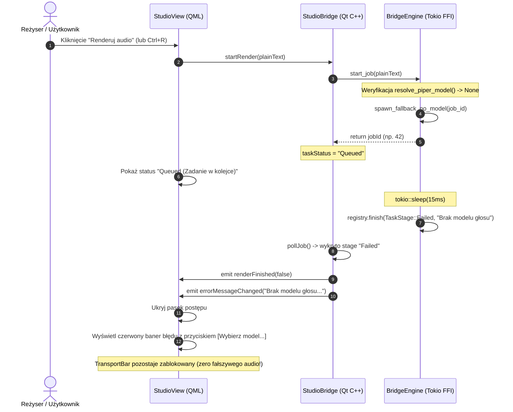

# M12 — Specyfikacja UX dla lokalnego Release Bundle Audioticon 2.0
**Director Workstation · Native Qt 6 / QML · In-Process Tokio FFI · 100% Offline**

**Data dokumentu:** 18 listopada 2026  
**Autor:** Antigravity (Architektura UI/UX & Systemy Wizualne)  
**Status:** Oficjalna specyfikacja interakcji, ergonomii, diagnostyki i obsługi błędów dla paczki instalacyjnej/release bundle  
**Dokumenty bazowe:**  
- [M9_UI_VISUAL_DIRECTION.md](file:///home/jaro/.openclaw/workspace/AUDIOTICON%202.0/M9_UI_VISUAL_DIRECTION.md) — kierunek artystyczny i paleta Glass
- [M10_UI_WALLPAPER_PREMIUM.md](file:///home/jaro/.openclaw/workspace/AUDIOTICON%202.0/M10_UI_WALLPAPER_PREMIUM.md) — silnik tła i kontrast
- [M10_RELEASE_AUDIT.md](file:///home/jaro/.openclaw/workspace/AUDIOTICON%202.0/M10_RELEASE_AUDIT.md) — audyt release i identyfikacja blockerów B1–B13
- [M11_RELEASE_FIXES.md](file:///home/jaro/.openclaw/workspace/AUDIOTICON%202.0/M11_RELEASE_FIXES.md) — naprawa technicznych blockerów (B1, B3, B2, B13)

---

## Wprowadzenie i manifest produktowy

Audioticon 2.0 jest **profesjonalną stacją roboczą reżyserii audiobooków klasy desktopowej**, zaprojektowaną jako w pełni autonomiczne oprogramowanie lokalne:
- **Zero Cloud / Air-Gapped Ready:** Aplikacja nigdy nie wysyła telemetrii, nie komunikuje się z serwerami zdalnymi, nie uruchamia lokalnego serwera HTTP ani WebView. Cała praca (parsowanie reżyserii, synteza głosu, mastering LUFS, odtwarzanie PCM) odbywa się w jednym natywnym procesie systemowym.
- **Odpowiedzialność za środowisko:** W przeciwieństwie do aplikacji chmurowych, lokalny pakiet audio zależy od zasobów maszyny użytkownika: obecności FFmpeg, modelu głosu ONNX, interpretera Piper oraz sterowników audio (PipeWire/PulseAudio/ALSA).
- **Zasada uczciwości UX (Anti-Deception):** Aplikacja nigdy nie ukrywa błędów środowiska za fałszywym stanem sukcesu (wyeliminowany w M11 błąd B13 ze statusem *Finished* na 200 ms ciszy). Każdy brak jest komunikowany precyzyjnie, estetycznie i ze wskazaniem natychmiastowej ścieżki rozwiązania.

---

## 1. Ekran pierwszego uruchomienia (First Run / Onboarding Wizard)

### 1.1. Warunki wywołania
Ekran pierwszego uruchomienia pojawia się automatycznie w dwóch przypadkach:
1. Pierwsze otwarcie aplikacji na danym profilu użytkownika (`QSettings: onboarded == false`).
2. Uruchomienie aplikacji w stanie krytycznym: brak aktywnego modelu głosu w `~/.local/share/audioticon/models/` oraz brak zmiennej `AUDIOTICON_PIPER_MODEL`.

Dla użytkowników posiadających już skonfigurowany model onboarding jest pomijany, a aplikacja otwiera bezpośrednio **StudioView**.

### 1.2. Architektura wizualna Onboardingu (Glass Modal Card)
Onboarding nie jest osobnym top-level oknem systemowym, lecz pełnoekranową nakładką **Glass Modal Overlay** wyrenderowaną ponad `WallpaperBackground`, gwarantując spójność wizualną z resztą stacji roboczej.

```
┌────────────────────────────────────────────────────────────────────────────────────────┐
│  AUDIOTICON 2.0  ·  DIRECTOR WORKSTATION                       [ 100% LOCAL RUNTIME ]  │
├────────────────────────────────────────────────────────────────────────────────────────┤
│                                                                                        │
│     ┌────────────────────────────────────────────────────────────────────────────┐     │
│     │  🎙️ WITAJ W AUDIOTICON 2.0 STUDIO                                         │     │
│     │  Lokalna cyfrowa stacja robocza do reżyserii i masteringu audiobooków      │     │
│     ├────────────────────────────────────────────────────────────────────────────┤     │
│     │                                                                            │     │
│     │  KROK 1 Z 3: WERYFIKACJA ŚRODOWISKA LOKALNEGO                              │     │
│     │                                                                            │     │
│     │  [●] Silnik Qt 6.12 Quick (Natywny GUI Linux)                 [ GOTOWY   ] │     │
│     │  [●] Rdzeń Rust FFI + Tokio Runtime (Przetwarzanie PCM)       [ POŁĄCZONY] │     │
│     │  [●] Narzędzia FFmpeg 9 (Eksport FLAC/MP3, Mastering LUFS)   [ ZNALEZIONY]│     │
│     │  [○] Model głosu lektorskiego Piper (.onnx)                   [ WYMAGANY ] │     │
│     │                                                                            │     │
│     │  ────────────────────────────────────────────────────────────────────────  │     │
│     │  Model głosu nie został wykryty w ~/.local/share/audioticon/models/        │     │
│     │  Wybierz pobrany wcześniej model z dysku lub uruchom tryb reżyserski.      │     │
│     │                                                                            │     │
│     │  [ 📁 Wybierz model z dysku (.onnx) ]     [ 🩺 Otwórz pełny Doctor ]       │     │
│     │                                                                            │     │
│     ├────────────────────────────────────────────────────────────────────────────┤     │
│     │  [ Pomiń syntezę (Tryb inspekcji reżyserii bez TTS) ]  [ Rozpocznij pracę ]│     │
│     └────────────────────────────────────────────────────────────────────────────┘     │
│                                                                                        │
└────────────────────────────────────────────────────────────────────────────────────────┘
```

### 1.3. Ścieżki decyzyjne onboardingu
1. **Wybór modelu z dysku (`Wybierz model`):**
   - Otwiera natywne okno wyboru pliku Qt (`FileDialog` filtrujący `*.onnx`).
   - Po wybraniu pliku aplikacja automatycznie sprawdza obecność towarzyszącego pliku metadanych `*.onnx.json`.
   - Zapisuje ścieżkę do `QSettings` jako `active_model_path`.
   - Wskaźnik zapala się na zielony cyjan (`#00e5ff`), przycisk `Rozpocznij pracę` staje się aktywny.
2. **Uruchomienie w trybie inspekcji (`Pomiń syntezę`):**
   - Pozwala natychmiast przejść do Studia. Użytkownik może edytować tekst, układać emoji, sprawdzać podział na zdania i kalkulację pauz, ale przycisk syntezy pozostaje zablokowany z czytelnym wyjaśnieniem.
3. **Przejście do diagnostyki (`Otwórz pełny Doctor`):**
   - Przełącza widok do pełnego ekranu diagnostycznego, jeśli użytkownik chce zweryfikować sterowniki audio lub venv Pythona.

---

## 2. Ekran Doctor / Diagnostyki (System Diagnostics)

### 2.1. Umiejscowienie w architekturze nawigacji
Doctor jest dostępny z trzech miejsc w aplikacji:
1. **NavRail (lewa szyna):** ikona `🩺` z podpisem `Doctor`.
2. **ContextInspector (prawy drawer):** zakładka `Doctor`.
3. **Kliknięcie w baner błędu w Studio:** skrót natychmiastowy przenoszący do problematycznego komponentu.

### 2.2. Układ modułu Doctor (Diagnostic Matrix)

```
┌────────────────────────────────────────────────────────────────────────────────────────────────────────┐
│ 🩺 AUDIOTICON DOCTOR  ·  DIAGNOSTYKA STACJI ROBOCZEJ                        [ KOPIUJ RAPORT DLA SUPPORTU]│
├────────────────────────────────────────────────────────────────────────────────────────────────────────┤
│                                                                                                        │
│ ┌───────────────────────────┐ ┌───────────────────────────┐ ┌───────────────────────────┐             │
│ │ 1. SILNIK GUI & FRAMEWORK │ │ 2. KARTA DŹWIĘKOWA (PCM)  │ │ 3. FFmpeg MASTERING CORE  │             │
│ │ ● STATUS: GOTOWY (OK)     │ │ ● STATUS: AKTYWNA         │ │ ● STATUS: GOTOWY (OK)     │             │
│ │ Qt 6.12.0 · GCC 16.2.1    │ │ QAudioSink: ALSA/PipeWire │ │ Wersja: n9.0.2            │             │
│ │ Backend: Linux / X11-xcb  │ │ Domyślne: USB Audio DAC   │ │ Ścieżka: /usr/bin/ffmpeg  │             │
│ │ Styl: Material Glass Dark │ │ Format: 44.1 kHz 16-bit   │ │ Filtry: loudnorm, soxr    │             │
│ │ Akceleracja: Software GL  │ │ Latencja bufora: 45 ms    │ │ Kodeki: FLAC, MP3, AAC    │             │
│ │ [ Informacje o systemie ] │ │ [ Testuj odsłuch (1 kHz)] │ │ [ Weryfikuj filtry ]      │             │
│ └───────────────────────────┘ └───────────────────────────┘ └───────────────────────────┘             │
│                                                                                                        │
│ ┌───────────────────────────┐ ┌───────────────────────────┐ ┌───────────────────────────┐             │
│ │ 4. PIPER TTS RUNTIME      │ │ 5. BAZA GŁOSÓW LEKTORSKICH│ │ 6. KOKORO ONNX (OPCJA)    │             │
│ │ ● STATUS: SKONFIGUROWANY  │ │ ○ STATUS: BRAK MODELU     │ │ ◌ STATUS: WYŁĄCZONY       │             │
│ │ Interpreter: python3.14   │ │ Aktywny: (brak wybranego) │ │ ORT Runtime: 1.32         │             │
│ │ Moduł: piper-tts 1.2.0    │ │ Magazyn: ~/.local/share...│ │ Biblioteka: (brak so)     │             │
│ │ Tryb: CLI Subprocess IPC  │ │ Modele zainstalowane: 0   │ │ Przeznaczenie: Angielski  │             │
│ │ Cache: 142 MB (38 zdań)   │ │ Wymóg: pl_PL-*.onnx       │ │ Wymagane: Opcjonalne      │             │
│ │ [ Zmień venv / Python ]   │ │ [ 📁 Wskaż plik .onnx ]   │ │ [ Konfiguruj ORT ]        │             │
│ └───────────────────────────┘ └───────────────────────────┘ └───────────────────────────┘             │
│                                                                                                        │
│ ────────────────────────────────────────────────────────────────────────────────────────────────────── │
│ KONSOLA ZDARZEŃ DIAGNOSTYCZNYCH (LIVE FFI & SUBSYSTEM LOG):                                            │
│ [12:30:14.102] [CORE]   Rust Tokio runtime initialized. Worker threads: 4. Staticlib linked (Release). │
│ [12:30:14.148] [AUDIO]  QAudioSink device opened successfully: 'ALC892 Analog' (SampleRate: 44100).   │
│ [12:30:14.205] [FFMPEG] ffprobe probe_audio_sample_rate registered. Subprocess test passed.          │
│ [12:30:14.220] [PIPER]  Searching for voice models in /home/jaro/.local/share/audioticon/models/...    │
│ [12:30:14.221] [WARN]   No voice models found. Transitioning TTS engine to Standby (Inspection Mode).  │
└────────────────────────────────────────────────────────────────────────────────────────────────────────┘
```

---

## 3. Matryca stanów krytycznych podsystemów

Każdy komponent posiada 4 ściśle określone stany wizualne z dedykowaną kolorystyką LED:

| Podsystem | Stan: Gotowy (`#00e5ff`) | Stan: Ostrzeżenie (`#ffd43b`) | Stan: Błąd krytyczny (`#ff5252`) | Stan: Wyłączony (`#52737e`) |
|---|---|---|---|---|
| **Qt Framework** | Qt 6.12 załadowane, styl Material aktywny | Starsza wersja Qt, brak akceleracji GPU | Brak pluginu platformy (np. brak xcb/wayland) | N/A |
| **Karta Audio** | `QAudioSink` gotowy, urządzenie aktywne | Urządzenie wstrzymane lub wysoka latencja | Brak karty dźwiękowej / brak uprawnień audio | Dźwięk wyciszony w ustawieniach |
| **FFmpeg** | FFmpeg 9 zainstalowany, filtry soxr dostępne | Brak ffprobe (weryfikacja sample rate ograniczona) | Brak `ffmpeg` w PATH — eksport zablokowany | N/A |
| **Piper TTS** | Środowisko Python z `piper-tts` sprawne | Powolna synteza CPU (długi czas renderu) | Brak Pythona lub brak paczki `piper-tts` | Tryb „Tylko reżyseria” |
| **Model Głosu** | Model `.onnx` załadowany i zweryfikowany | Model nieposiadający metadanych `.json` | Brak jakiegokolwiek modelu głosu | N/A |
| **ORT (Kokoro)** | Biblioteka `libonnxruntime.so` podpięta | Wersja ORT inna niż zalecana 1.32 | Błąd ładowania symboli biblioteki dynamicznej | Wyłączony (stan domyślny) |

### 3.1. Szczegółowe zachowanie dla każdego stanu

#### A. Qt dostępne (Stan normalny)
- **Komunikat:** `Natywny interfejs Qt 6.12 (GCC 16, x86_64) — Gotowy`.
- **Wpływ na UX:** Pełna płynność animacji 60 FPS, panele Glass responsywne, skróty klawiaturowe aktywne.

#### B. FFmpeg brak (Błąd funkcjonalny)
- **Komunikat w Doctorze:** `Brak programu FFmpeg w ścieżce systemowej (PATH)`.
- **Wpływ na Studio:**
  - Odsłuch w Studio działa normalnie (QAudioSink odtwarza bezpośrednio master WAV).
  - W prawym panelu Eksportu przyciski `Eksportuj FLAC`, `Eksportuj MP3`, `Generuj M4B` zostają wyszarzone.
  - Nad przyciskami pojawia się badge ostrzegawczy:  
    `⚠️ Eksport wymaga FFmpeg. Zainstaluj pakiet systemowy, aby aktywować kodowanie.`
  - Przycisk `[ Napraw... ]` otwiera okno z poleceniem dla dystrybucji użytkownika (`sudo pacman -S ffmpeg` / `sudo apt install ffmpeg`).

#### C. Piper brak (Błąd środowiska wykonawczego)
- **Komunikat w Doctorze:** `Nie wykryto środowiska wykonawczego Piper TTS (Python / piper-tts)`.
- **Wpływ na Studio:**
  - Przycisk `🎙️ Renderuj audio` w StudioView jest zastąpiony przez `⚠️ Skonfiguruj Piper TTS`.
  - Kliknięcie przycisku przenosi do Doctora z podpowiedziami konfiguracji venv.
  - Użytkownik nadal może pracować nad tekstem i dyrektywami emoji.

#### D. Model głosu brak (Stan po świeżej instalacji bez assetów)
- **Komunikat w Doctorze:** `Brak zainstalowanego modelu głosu lektorskiego (.onnx)`.
- **Wpływ na Studio (Spójność z M11 B13):**
  - Przycisk renderowania ma stan ostrzegawczy z tooltipem: `Wymaga wskazania pliku modelu .onnx`.
  - W przypadku wywołania renderowania przez skrót klawiszowy `Ctrl+R`:
    - Status natychmiast raportuje: `Failed` (brak fałszywego *Finished*!).
    - Status message: `Brak modelu głosu`.
    - Error message: `Brak modelu głosu (ustaw AUDIOTICON_PIPER_MODEL lub wskaż plik)`.
    - W StudioView pojawia się baner błędu z bezpośrednim przyciskiem `[ 📁 Wybierz model... ]`.
    - Odtwarzacz `TransportBar` pozostaje w stanie bezczynnym (`Idle`) — nie próbuje odtwarzać nieistniejącego pliku.

#### E. ORT opcjonalny (Moduł eksperymentalny Kokoro)
- **Komunikat w Doctorze:** `ONNX Runtime: Opcjonalny (Nieużywany przez silnik Piper)`.
- **Wpływ na UX:**
  - Szary wskaźnik LED (`#52737e`).
  - Jasna informacja: *„Podstawowy silnik lektorski Piper korzysta z własnego zintegrowanego środowiska. Biblioteka ORT jest wymagana tylko w przypadku aktywacji eksperymentalnego głosu Kokoro.”*
  - Brak nachalnych komunikatów o błędzie — aplikacja uznaje ten stan za w 100% poprawny dla wydania v1.

#### F. Urządzenie audio niedostępne (Awaria karty / serwera dźwięku)
- **Komunikat w Doctorze:** `Nie można otworzyć urządzenia odtwarzania audio (QAudioSink)`.
- **Wpływ na Studio:**
  - Wskaźnik w `TransportBar` przybiera stan czerwony: `[ 🔇 Brak karty audio ]`.
  - Przyciski `Play`, `Pause`, `Scrub` zostają zablokowane.
  - Renderowanie do pliku WAV **nadal działa** (użytkownik może reżyserować i eksportować pliki nawet na bezgłowej maszynie lub przy odłączonych słuchawkach).
  - Baner informacyjny: *„Plik został poprawnie wygenerowany na dysku, lecz lokalny serwer dźwięku (PipeWire/ALSA) nie zgłasza aktywnego wyjścia audio.”*

---

## 4. Przyciski akcji i mikrointerakcje naprawcze

Wszystkie akcje naprawcze zostały zaprojektowane tak, aby użytkownik nie musiał samodzielnie przeszukiwać systemu plików ani dokumentacji:

### 4.1. Przycisk „Napraw” (Contextual Resolution Dialog)
- **Gdzie się pojawia:** Przy kafelkach FFmpeg, Pythona i Uprawnień Audio w widoku Doctor.
- **Działanie:** Wyświetla modalną kartę Glass z gotowymi, precyzyjnymi instrukcjami terminalowymi dla wykrytej dystrybucji Linuksa (np. na bazie `/etc/os-release` rozpoznaje Arch Linux / Debian / Fedora):
  ```
  ┌─────────────────────────────────────────────────────────────┐
  │  NAPRAWA ZALEŻNOŚCI: FFMPEG                                 │
  ├─────────────────────────────────────────────────────────────┤
  │  Wykryto system: Arch Linux (Rolling)                       │
  │  Aby aktywować mastering FLAC, MP3 i pomiar LUFS, wykonaj:  │
  │                                                             │
  │  $ sudo pacman -S ffmpeg                                    │
  │                                                             │
  │  [ Kopiuj polecenie ]                     [ Zamknij ]       │
  └─────────────────────────────────────────────────────────────┘
  ```

### 4.2. Przycisk „Wybierz plik” (Native File Picker)
- **Gdzie się pojawia:** W widoku Onboardingu, w kafelku *Model Głosu* w Doctorze oraz w banerze błędu braku modelu w StudioView.
- **Działanie:** Wywołuje natywny dialog wyboru pliku:
  - Filtr główny: `Modele Piper ONNX (*.onnx)`.
  - Po zatwierdzeniu aplikacja sprawdza sumę kontrolną i rozmiar. Jeśli plik jest prawidłowy, natychmiast przepisuje sesję silnika FFI (`BridgeEngine`) bez konieczności restartu całego GUI.

### 4.3. Przycisk „Otwórz dokumentację” (Offline Documentation)
- **Gdzie się pojawia:** W nagłówku Doctora, w sekcji pomocy i w stopce ekranu onboardingu.
- **Działanie:**
  - Uruchamia domyślną przeglądarkę systemową na lokalnym protokole `file://`:  
    `file:///home/jaro/.openclaw/workspace/AUDIOTICON%202.0/docs/index.html` (lub lokalny czytnik Markdown).
  - W przypadku braku przeglądarki otwiera wbudowaną przeglądarkę tekstową Glass w aplikacji.
  - **Bezwzględny brak odwołań HTTP:** Żaden odnośnik nie prowadzi do zewnętrznych stron internetowych.

### 4.4. Przycisk „Uruchom bez TTS” (Director Standby Mode)
- **Gdzie się pojawia:** W onboarding wizardzie oraz w widoku braku modelu.
- **Działanie:**
  - Zamyka ostrzeżenia o braku modelu.
  - Przełącza StudioView w tryb *Scenariusz & Reżyseria*.
  - Pasek stanu w NavRail wyświetla: `Tryb: Reżyseria (Czysty tekst)`.
  - Pozwala na pełne formatowanie, podgląd pauz, estymację czasu trwania audiobooka na bazie średniej prędkości lektora (słowa na minutę) bez obciążania procesora syntezą.

---

## 5. Prezentacja licencji i pochodzenia modeli

Ze względu na zróżnicowanie prawne modeli mowy (od pełnego open-source MIT po rygorystyczne licencje niekomercyjne CC-BY-NC), Audioticon 2.0 traktuje atrybucję modeli z najwyższą powagą:

### 5.1. Karta Identyfikacyjna Modelu (Voice Model Card)
Każdy załadowany model prezentowany jest w panelu *Modele i Głosy* w formie cyfrowej wizytówki:

```
┌────────────────────────────────────────────────────────────────────────────┐
│  🎙️ GŁOS: POLSKI BASS (LEKTOR MĘSKI)                    [ AKTYWNY: DOMYŚLNY ]│
├────────────────────────────────────────────────────────────────────────────┤
│  Plik: pl_PL-bass-high.onnx (114 MB) · 24 000 Hz Mono                      │
│  Architektura: Piper VITS (Medium-High Precision)                          │
│  Trener / Pochodzenie: Społeczność Open-Source / HuggingFace               │
│                                                                            │
│  STATUS LICENCJI:                                                          │
│  [ BADGE: MIT LICENSE ]  ·  Zezwala na użytek komercyjny i prywatny        │
│                                                                            │
│  Treść atrybucji:                                                          │
│  "Model mowy pl_PL-bass wytrenowany w oparciu o otwarte korpusy lektorskie.│
│   Wydany na licencji MIT. Copyright (c) 2024 Twórcy modelu."              │
│                                                                            │
│  [ Wyświetl pełny tekst licencji ]              [ Zmień przypisanie głosu ]│
└────────────────────────────────────────────────────────────────────────────┘
```

### 5.2. Ostrzeżenia licencyjne w eksporcie masteringu
- Jeśli aktywny model posiada licencję **CC-BY-NC** (Non-Commercial), metadane ID3 / FLAC Comment otrzymują automatyczny wpis:  
  `License: Creative Commons Non-Commercial (CC-BY-NC 4.0)`.
- W oknie eksportu książki pojawia się subtelne ostrzeżenie:  
  `ℹ️ Wybrany głos lektorski posiada licencję niekomercyjną. Dystrybucja płatna wymaga zmiany modelu.`

### 5.3. Dostęp do licencji trzecich (Third-Party Notices)
- Zakładka `Licencje i Prawa` w Ustawieniach wyświetla wbudowany plik `THIRD_PARTY_NOTICES.md` (licencje Qt, FFmpeg LGPL/GPL, Piper MIT, Rust crates, czcionki Inter/JetBrains Mono).

---

## 6. Gwarancja lokalności i prywatności (Zero Cloud / No HTTP)

Aby inżynierowie dźwięku, wydawnictwa i autorzy mieli 100% pewności co do poufności swoich manuskryptów, interfejs w sposób ciągły komunikuje lokalny charakter stacji roboczej:

1. **Badge w HeaderBarze:**
   - Obok sygnetu Audioticon stale widoczny jest wskaźnik:  
     `[ 🔒 100% LOCAL RUNTIME · AIR-GAPPED ]`
   - Po najechaniu myszą wyświetla się dymek:  
     *„Wszystkie operacje syntezy i masteringu wykonywane są na Twoim procesorze. Aplikacja nie nasłuchuje na żadnym porcie sieciowym ani nie łączy się z serwerami zewnętrznymi.”*
2. **Brak jakichkolwiek zapytań sieciowych:**
   - Aplikacja nie posiada funkcji „Pobierz model z internetu” wewnątrz GUI — użytkownik sam decyduje, jakie pliki wgrywa na swoją maszynę.
   - Wyciszono wszelkie próby sprawdzania aktualizacji przez sieć w locie; sprawdzanie aktualizacji (`updater.rs`) działa wyłącznie na bazie lokalnie dostarczonych plików manifestu lub paczek repozytorium.

---

## 7. Zachowanie przy braku modelu (Eliminacja fałszywego sukcesu)

Zgodnie z implementacją dokonaną w kroku M11 (naprawa technicznego blockera B13), interfejs użytkownika w pełni respektuje transparentność procesu syntezy:

### 7.1. Przepływ zdarzeń w przypadku braku modelu



### 7.2. Detale prezentacji błędu w StudioView
1. **Pasek postępu (`ProgressBar`):** zamiast dochodzić do 100% i znikać, natychmiast zmienia kolor z cyjanu na stonowaną czerwień `#ff5252`, zatrzymuje się na 0% i po 400 ms znika.
2. **Baner błędu (Error Banner):**
   ```
   ┌────────────────────────────────────────────────────────────────────────────────────────┐
   │ 🛑 BŁĄD SYNTEZY: Brak aktywnego modelu głosu lektorskiego                               │
   │ Ustaw zmienną AUDIOTICON_PIPER_MODEL lub wskaż pobrany plik .onnx na dysku.             │
   │ [ 📁 Wskaż plik modelu... ]                                  [ 🩺 Diagnostyka ] [ ✕ ] │
   └────────────────────────────────────────────────────────────────────────────────────────┘
   ```
3. **Pamięć podręczna (Cache tiles):** kafelki cache segmentów nie zgłaszają ani `HIT`, ani `MISS`, lecz pozostają w stanie neutralnym `STANDBY`.

---

## 8. Wygląd komunikatów błędów zgodny z Director Workstation

Komunikaty o błędach w Audioticon 2.0 odrzucają standardowe, białe okienka systemowe OS-a na rzecz zintegrowanej estetyki **Audioticon Director Workstation**:

### 8.1. Tokeny wizualne komunikatów (Design Tokens)

| Element | Wartość stylu | Opis |
|---|---|---|
| **Tło baneru błędu** | `Qt.rgba(0.08, 0.02, 0.03, 0.92)` | Głęboki akryl z domieszką burgundu |
| **Obramowanie (Border)** | `1px solid #ff3366` | Precyzyjny neonowy obrys ostrzegawczy |
| **Tło ostrzeżenia (Warning)**| `Qt.rgba(0.08, 0.06, 0.02, 0.92)` | Ciemny akryl bursztynowy |
| **Obrys ostrzeżenia** | `1px solid #ffd43b` | Ciepły vintage amber |
| **Typografia nagłówka** | `Inter / Noto Sans SemiBold 11pt` | Wysoka czytelność w warunkach studyjnych |
| **Typografia kodu błędu**| `JetBrains Mono Regular 9.5pt` | Monospace dla logów i ścieżek FFI |
| **Zaokrąglenie rogów** | `radius: 6px` | Techniczny, zwarty promień krawędzi |
| **Cień (Glow)** | `color: "#33ff3366", blur: 12px` | Dyskretna poświata w stylu rack audio |

### 8.2. Poziomy powiadomień
1. **Toast Notification (Dolny prawy róg):** Drobne potwierdzenia (np. *„Skopiowano ścieżkę do schowka”*, *„Zapisano ustawienia tapety”*).
2. **Inline Strip Banner (Pod edytorem reżyserii):** Błędy parsowania dyrektyw emoji, ostrzeżenia o brakującym modelu, błędy urządzenia audio.
3. **Inspector Drill-down (W prawym panelu):** Rozwinięcie szczegółów błędu (pełny stacktrace błędu FFI, wyjście procesu FFmpeg).

---

## 9. Tryb ekspercki dla ścieżek XDG, ORT i Piper

Dla zaawansowanych realizatorów dźwięku i administratorów Linuksa w sekcji `Ustawienia` oraz `Doctor` dostępny jest przełącznik **[ Tryb ekspercki (Środowisko & XDG) ]**:

### 9.1. Mapa ścieżek środowiska XDG

```
┌────────────────────────────────────────────────────────────────────────────────────────┐
│ ⚙️ ŚCIEŻKI ŚRODOWISKA SYSTEMOWEGO (XDG & RUNTIME)                     [ PRZYWRÓĆ DOMYŚLNE ]│
├────────────────────────────────────────────────────────────────────────────────────────┤
│                                                                                        │
│ 1. KATALOG MODELI MOWY (XDG_DATA_HOME)                                                 │
│    Ścieżka: ~/.local/share/audioticon/models/                                          │
│    Status: [ Dostępny · 0 plików · Zapisywalny ]                 [ Otwórz w menedżerze ]│
│                                                                                        │
│ 2. ZMIENNA AUDIOTICON_PIPER_MODEL (NADRZĘDNA)                                          │
│    Wartość: (nieustawiona)                                                             │
│    Wpływ: Brak stałego przypisania modelu; silnik szuka w models/ [ Ustaw zmienną... ] │
│                                                                                        │
│ 3. PAMIĘĆ PODRĘCZNA PRÓBEK AUDIO (XDG_CACHE_HOME)                                      │
│    Ścieżka: ~/.cache/audioticon/segments/                                              │
│    Status: [ 38 plików WAV · 142.4 MB zajęte ]                   [ Wyczyść cache LRU ] │
│                                                                                        │
│ 4. KONFIGURACJA UŻYTKOWNIKA (XDG_CONFIG_HOME)                                          │
│    Ścieżka: ~/.config/audioticon/                                                      │
│    Status: [ audioticon.conf · Istnieje ]                        [ Edytuj konfigurację]│
│                                                                                        │
│ 5. ŚRODOWISKO PIPER PYTHON RUNTIME                                                     │
│    Ścieżka: ~/.local/share/audioticon/venv/bin/python3                                 │
│    Status: [ Python 3.14.2 · piper-tts v1.2.0 wykryty ]          [ Zmień interpreter ] │
│                                                                                        │
│ 6. BIBLIOTEKA ONNX RUNTIME DYLIB (OPCJA KOKORO)                                        │
│    Zmienna: ORT_DYLIB_PATH                                                             │
│    Wartość: (brak przypisania)                                                         │
│    Status: [ Moduł nieaktywny — brak wpływu na Piper ]           [ Wskaż .so... ]      │
└────────────────────────────────────────────────────────────────────────────────────────┘
```

### 9.2. Funkcje trybu eksperckiego
- **Weryfikacja praw dostępu:** Aplikacja weryfikuje czy katalogi posiadają prawa do zapisu (`rwx`). Jeśli użytkownik uruchomił aplikację w katalogu tylko do odczytu, otrzymuje czytelne ostrzeżenie.
- **Jedno-klikowy eksport raportu:** Przycisk `Generuj plik debug.log` tworzy w `~/.local/share/audioticon/` pełny zrzut zmiennych środowiskowych, wersji bibliotek i konfiguracji urządzeń audio.

---

## 10. Kryteria akceptacji UX (100% Offline & Bez instalacji zależności)

Poniższe scenariusze stanowią bezwzględne kryteria akceptacji dla jakości wydania Audioticon 2.0:

### Scenariusz A: Świeże uruchomienie na „czystej” maszynie (Brak modeli)
- [ ] **Kryterium A1:** Aplikacja uruchamia się bez zawieszenia i bez crasha w czasie poniżej 1.5 sekundy.
- [ ] **Kryterium A2:** Pojawia się elegancki ekran Onboardingu informujący o braku modelu głosu.
- [ ] **Kryterium A3:** Aplikacja **nie podejmuje żadnych prób połączeń sieciowych** (brak zapytań DNS, brak HTTP GET, brak pobierania wag modeli w tle).
- [ ] **Kryterium A4:** Użytkownik może kliknąć „Pomiń syntezę” i wejść do Studia w trybie edycji reżyserskiej.
- [ ] **Kryterium A5:** Próba renderowania raportuje stan `Failed` z jasnym komunikatem `Brak modelu głosu` — brak generowania fałszywych plików ciszy 200 ms.

### Scenariusz B: Wskazanie modelu z dysku lokalnego
- [ ] **Kryterium B1:** Kliknięcie `Wskaż plik modelu...` otwiera dialog systemowy filtrujący pliki `.onnx`.
- [ ] **Kryterium B2:** Po wskazaniu pliku model zostaje zweryfikowany w pamięci w czasie < 200 ms.
- [ ] **Kryterium B3:** Pasek stanu w NavRail zmienia status na `Model: <nazwa_pliku>` z zieloną diodą LED.
- [ ] **Kryterium B4:** Przycisk `Renderuj audio` zostaje odblokowany, a kliknięcie generuje prawdziwy dźwięk lektorski.

### Scenariusz C: Brak programu FFmpeg w systemie
- [ ] **Kryterium C1:** Aplikacja startuje stabilnie, Doctor oznacza kafelek FFmpeg żółtym kolorem ostrzegawczym.
- [ ] **Kryterium C2:** Odsłuch w Studio działa normalnie na masterze WAV.
- [ ] **Kryterium C3:** W panelu Eksportu przyciski FLAC, MP3, M4B są wyszarzone z tooltipem: `Wymaga pakietu FFmpeg`.
- [ ] **Kryterium C4:** Przycisk `Napraw` wyświetla gotową instrukcję instalacji pakietu systemowego.

### Scenariusz D: Brak lub awaria karty dźwiękowej
- [ ] **Kryterium D1:** Aplikacja nie rzuca nieobsłużonego wyjątku przy braku urządzenia wyjściowego `QAudioSink`.
- [ ] **Kryterium D2:** Pasek transportu audio przechodzi w stan `Brak wyjścia audio`, przyciski odtwarzania są wyszarzone.
- [ ] **Kryterium D3:** Funkcja syntezy do pliku WAV na dysku nadal działa bez przeszkód (render offline).

### Scenariusz E: Praca w środowisku w pełni odciętym od sieci (Air-Gapped)
- [ ] **Kryterium E1:** Przy całkowicie odłączonym interfejsie sieciowym (`ip link set lo up` / brak internetu) 100% funkcji aplikacji, w tym Doctor, Onboarding, Edytor Emoji, Odtwarzacz WAV i Eksport, działa bez jakichkolwiek opóźnień czy timeoutów sieciowych.
- [ ] **Kryterium E2:** Kliknięcie `Otwórz dokumentację` otwiera lokalną kopię plików bez błędów sieciowych.

---

## Podsumowanie architektoniczne dla implementacji QML

Specyfikacja M12 stanowi bezpośredni podręcznik wdrożeniowy dla przyszłych komponentów QML w katalogu `ui/src/qml/`:
1. `OnboardingModal.qml` — modalny kreator pierwszego uruchomienia.
2. `DoctorView.qml` — centralna matryca diagnostyczna podsystemów.
3. `VoiceModelCard.qml` — karta identyfikacyjna modelu z prezentacją licencji.
4. `ExpertPathsDrawer.qml` — panel inspekcji zmiennych XDG i ścieżek FFI.

Całość zachowuje ścisłą kompatybilność z wzorcem **ASTRA Glass Dark Material**, paletą neonów audio (cyjan `#00e5ff`, bursztyn `#ffd43b`, czerwień `#ff5252`) oraz kontraktem FFI udostępnianym przez [StudioBridge.h](file:///home/jaro/.openclaw/workspace/AUDIOTICON%202.0/ui/src/bridge/StudioBridge.h).
