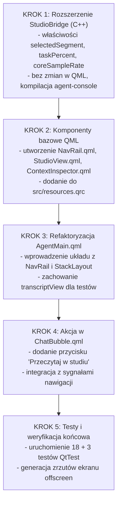

# M5 — Szczegółowy plan implementacji UI Audioticon 2.0

**Data utworzenia:** 2026-11-18  
**Autor:** Antigravity (Architektura UI & Systemów Natywnych)  
**Dokument bazowy:** [`/home/jaro/.openclaw/workspace/AUDIOTICON 2.0/M5_UI_LAYOUT_SPEC.md`](file:///home/jaro/.openclaw/workspace/AUDIOTICON%202.0/M5_UI_LAYOUT_SPEC.md)  
**Środowisko:** [`/home/jaro/.openclaw/workspace/AUDIOTICON 2.0/ui`](file:///home/jaro/.openclaw/workspace/AUDIOTICON%202.0/ui)  
**Status techniczny:** 18/18 testów QtTest zielonych (`M4_FFI_LINK_PROOF.md`), kod produkcyjny i testowy nienaruszony.

---

## 0. Zasady nadrzędne i ograniczenia projektowe

1. **Parser dyrektyw pozostaje w C++ E1:**  
   Pojedynczym źródłem prawdy dla gramatyki emoji, podziału na segmenty, wyliczania pauz i normalizacji polszczyzny jest moduł C++ E1:  
   [`src/core/voice/DirectiveParser.h`](file:///home/jaro/.openclaw/workspace/AUDIOTICON%202.0/ui/src/core/voice/DirectiveParser.h) oraz [`PolishVerbalizer.h`](file:///home/jaro/.openclaw/workspace/AUDIOTICON%202.0/ui/src/core/voice/PolishVerbalizer.h), zweryfikowane 44+11 przypadkami testów golden (`tts-golden.json`).
2. **Zakaz dublowania parsera w Ruście:**  
   Rust odpowiada wyłącznie za FFI, silnik audio, sentence cache SHA-256 oraz mikser/mastering. Nie implementujemy alternatywnego parsera tekstu w Ruście.
3. **Zakaz HTTP i WebView:**  
   Audioticon 2.0 jest w 100% natywną aplikacją desktopową Qt 6 / QML / C++17. Brak serwera HTTP, brak REST API, brak Electrona, brak komponentów webowych.
4. **Zero zmian w kodzie w niniejszym kroku:**  
   Dokument jest planem wykonawczym; żadne pliki źródłowe nie są modyfikowane przed zatwierdzeniem planu.

---

## 1. Zmiany w `AgentMain.qml` (Przekształcenie w Główną Powłokę Aplikacji)

Obecny plik `AgentMain.qml` (22k LOC) to monolityczny widok konsoli agenta (sesje | transkrypt | runtime). Przekształcamy go w modułową powłokę aplikacji (**App Shell**), zachowując 100% kompatybilności z istniejącymi testami jednostkowymi.

### 1.1 Wymagania kompatybilności wstecznej (Testy QtTest)
Test `Tests::agentConsoleRenders()` wyszukuje obiekt o nazwie:
```cpp
auto *list = window->findChild<QObject *>("transcriptView");
```
Oraz sprawdza jego właściwość `count` i zachowanie `feed.strip`. Dlatego widok transkryptu agenta **musi pozostać trwałym elementem drzewa obiektów Qt Quick** (np. w kontenerze `StackLayout` lub z zachowaniem nazwy `objectName: "transcriptView"`), a nie być usuwany z pamięci przy zmianie zakładki.

### 1.2 Struktura przebudowanego `AgentMain.qml`
```
ApplicationWindow (id: win, 1180x850, min: 780x560)
 ├── Właściwości globalne:
 │    property color accent: feed.accent
 │    property double glass: feed.glass
 │    property string activeModule: "studio"   // "studio" | "agent" | "voicelab" | ...
 │    property bool inspectorPinned: true
 │    property bool inspectorOpen: false
 ├── Header (RowLayout)
 │    ├── Logo "Λ AUDIOTICON 2.0"
 │    ├── Badge aktywnego projektu ("Projekt: Bez tytułu")
 │    ├── Wskaźnik głosu ("Głos: pl_bass · 22kHz")
 │    ├── Zegar czasu rzeczywistego (monospace)
 │    ├── Przycisk [☰ Panel] (przełącza inspectorOpen)
 │    └── Przycisk [⚙ Ustawienia]
 ├── Główny obszar roboczy (RowLayout)
 │    ├── NavRail (id: navRail, width: 56 lub 180)
 │    ├── Centralny kontener modułów (StackLayout, currentIndex: activeModuleIndex)
 │    │    ├── StudioView (index 0, id: studioView)
 │    │    ├── AgentView  (index 1, id: agentView, ZAWIERA transcriptView!)
 │    │    ├── VoiceLabPlaceholder (index 2)
 │    │    └── ProjectsPlaceholder (index 3)
 │    └── ContextInspector (id: contextInspector, width: 320, docked lub overlay drawer)
 └── Dolny pasek telemetrii: StateStrip (s: feed.strip)
```

---

## 2. Nowy komponent: `NavRail.qml`

### 2.1 Plik i lokalizacja
`ui/src/qml/NavRail.qml` (rejestrowany w `src/resources.qrc`).

### 2.2 Odpowiedzialność
Pionowy pasek nawigacyjny po lewej stronie okna, przełączający aktywny moduł aplikacji.

### 2.3 Kontrakt właściwości i sygnałów
```qml
Item {
    id: rail
    property string currentModule: "studio"
    property bool collapsed: win.width < 1180
    signal moduleSelected(string moduleId)

    implicitWidth: collapsed ? 58 : 176
    Layout.fillHeight: true

    // Lista modułów (definicja modelu)
    readonly property var modules: [
        { id: "studio",   icon: "🎙️", label: qsTr("Studio"),    badge: studio.segments.length > 0 ? studio.segments.length : "" },
        { id: "agent",    icon: "💬", label: qsTr("Czat AI"),    badge: feed.streaming ? "●" : "" },
        { id: "voicelab", icon: "👥", label: qsTr("VoiceLab"),   badge: "" },
        { id: "projects", icon: "📁", label: qsTr("Projekty"),   badge: "" },
        { id: "sfx",      icon: "🔊", label: qsTr("Foley/SFX"),  badge: "" },
        { id: "ledger",   icon: "📊", label: qsTr("ACX Ledger"), badge: "" }
    ]
}
```

### 2.4 Ergonomia wizualna
- Tło ze szkła ASTRA: `Rectangle { color: Qt.rgba(.025, .045, .065, feed.glass); border.color: "#1e3a43" }`.
- Wskaźnik aktywnego modułu: pionowy neonowy pasek o szerokości 3 px w kolorze `win.accent` przy lewej krawędzi aktywnego przycisku.
- Skróty klawiszowe w tooltipach: `Ctrl+1` (Studio), `Ctrl+2` (Czat), itp.

---

## 3. Nowy komponent: `StudioView.qml`

### 3.1 Plik i lokalizacja
`ui/src/qml/StudioView.qml` (rejestrowany w `src/resources.qrc`).

### 3.2 Odpowiedzialność
Główny warsztat produkcyjny audio, dzielący przestrzeń na trzy ergonomiczne sekcje:

```
┌────────────────────────────────────────────────────────────────────────┐
│ 1. DIRECTIVE COMPOSER (Edytor tekstu ze znacznikami emoji)             │
│    [📖 Rozdział] [🛑 Stop 900ms] [⏸️ Pauza] [😮‍💨 Oddech] [🐢] [🐇] [📻] [🤫] │
│    TextArea: "Rozdział 1: Początek. 🛑 Wtedy lektor rzekł... 🐢"      │
│    Pasek akcji: [🎙️ Reżyseruj (C++ E1)]  [▶ Syntetyzuj wszystko]      │
├────────────────────────────────────────────────────────────────────────┤
│ 2. SEGMENT TIMELINE VIEW (Lista wyodrębnionych zdań ze statusem cache) │
│    ListView { model: studio.segments }                                 │
│    Wiersz segmentu:                                                    │
│    [#01] "Rozdział 1: Początek"     | Pauza: 900ms | HIT  | [▶ Odsłuch]│
│    [#02] "Wtedy lektor rzekł cicho" | DSP: Radio   | MISS | [▶ Odsłuch]│
├────────────────────────────────────────────────────────────────────────┤
│ 3. TRANSPORT BAR (Pasek odtwarzacza audio)                             │
│    [⏮] [ ▶ Graj cały rozdział ] [⏸] [⏭]  [Scrubber: 00:14 / 02:45]    │
└────────────────────────────────────────────────────────────────────────┘
```

### 3.3 Kluczowe powiązania danych (Data Bindings)
1. **Edytor → Parser C++ E1:**  
   Każda zmiana w `TextArea` wywołuje z opóźnieniem (debounce 150 ms) metodę `studio.parseDirectedText(text)`.
2. **Lista segmentów:**  
   Wiersze korzystają z modelu `studio.segments` (zwracanego z C++ jako `QVariantList` map zawierających `index`, `text`, `speed`, `dsp`, `pauseMs`, `hash`).
3. **Plakietki Cache (`HIT` / `MISS`):**  
   Zielony badge `#31f7a5` oznacza obecność w cache (`~/.cache/audioticon/segments/`). Kliknięcie [▶] odtwarza natychmiast bufor dźwiękowy.
4. **Interakcja z Inspektorem:**  
   Kliknięcie wiersza segmentu ustawia `studio.selectedSegmentIndex = index` i automatycznie otwiera prawy panel w zakładce Inspektora.

---

## 4. Nowy komponent: `ContextInspector.qml`

### 4.1 Plik i lokalizacja
`ui/src/qml/ContextInspector.qml` (rejestrowany w `src/resources.qrc`).

### 4.2 Odpowiedzialność
Kontekstowa szuflada / panel boczny (szerokość 320 px) obsługujący dwa stany:
- **Stan Docked (Przypięty):** zajmuje prawą kolumnę siatki okna.
- **Stan Drawer (Pływający):** wysuwany zza prawej krawędzi okna z cieniem overlay przy małych rozdzielczościach.

### 4.3 Nawigacja zakładek i struktura treści
Nagłówek panelu zawiera przyciski zakładek:
`[Inspektor] [Kolejka] [Głosy] [Materiały] [Eksport] [Ustawienia] [Doctor]`

1. **Zakładka `Inspektor segmentu` (Domyślna przy pracy w Studio):**
   - ID segmentu, tytuł rozdziału.
   - Suma kontrolna SHA-256 segmentu z przyciskiem kopiowania.
   - Modyfikatory: tempo (`speed`), filtr akustyczny (`dsp`), pauza końcowa (`pauseMs`).
   - Podgląd pętli audio / piki waveformu.
   - Przyciski: `[▶ Odsłuchaj pojedynczo]` oraz `[🔄 Wymuś re-syntezę]`.
2. **Zakładka `Kolejka zadań`:**
   - Stan `studio.taskStatus` (`Queued`, `Synthesizing`, `Mastering`, `Finished`).
   - Wskaźnik postępu `studio.taskPercent` (ProgressBar).
   - Przycisk `[Anuluj zadanie]`.
3. **Zakładka `Diagnostyka (Doctor)`:**
   - Wskaźnik połączenia FFI: status `AudioticonCore::core_version()` (= 44100).
   - Wykorzystanie pamięci RAM i rozmiar cache na dysku.

---

## 5. Integracja obiektów kontekstowych (`feed`, `i18n`, `studio`)

W `src/agent/main.cpp` silnik QML otrzymuje 3 niezależne obiekty kontekstowe:

| Obiekt kontekstowy | Klasa C++ | Odpowiedzialność |
|---|---|---|
| **`feed`** | `AgentModel` | Stan czatu asystenta, sesje, stream tokenów, zużycie kontekstu, motyw (`accent`, `glass`), dane dla `StateStrip`. |
| **`i18n`** | `Translator` | Tłumaczenia interfejsu w locie (język polski / angielski), funkcja `qsTr()`. |
| **`studio`** | `StudioBridge` | Parser reżyserii C++ E1, lista segmentów, odtwarzacz PCM/WAV, status kolejki renderowania. |

### 5.1 Przepływ akcji: „Przeczytaj w studiu” (Chat → Studio)
1. W komponencie `ChatBubble.qml` dla wiadomości typu `assistant` dodajemy przycisk:
   ```qml
   Button {
       text: qsTr("🎙️ Przeczytaj w studiu")
       visible: message.role === "assistant" && message.body.length > 0
       onClicked: {
           studio.parseDirectedText(message.body);
           win.activeModule = "studio";
       }
   }
   ```
2. Kliknięcie natychmiast:
   - Wstrzykuje wygenerowany przez LLM tekst do silnika reżyserii `DirectiveParser`,
   - Aktualizuje listę segmentów `studio.segments`,
   - Przełącza widok okna głównego na moduł **Studio**,
   - Ustawia fokus w edytorze tekstu.

---

## 6. Mapowanie prawych paneli na właściwości i model Qt

W klasie `StudioBridge` rozszerzamy zestaw właściwości `Q_PROPERTY` (bez dotykania kodu Rusta):

| Zakładka panelu | Właściwość C++ (`StudioBridge`) | Typ danych | Wykorzystanie w QML |
|---|---|---|---|
| **Inspektor** | `selectedSegment` | `QVariantMap` | `{ "index": 0, "text": "...", "hash": "c4f8...", "dsp": "radio", "speed": 1.15 }` |
| **Inspektor** | `selectedSegmentIndex` | `int` | Indeks aktualnie podświetlonego zdania na osi czasu |
| **Kolejka** | `taskStatus` | `QString` | Tekstowy stan: `"Idle"`, `"Synthesizing"`, `"Finished"` |
| **Kolejka** | `taskPercent` | `double` | Liczba 0.0 – 100.0 zasilająca `ProgressBar` |
| **Kolejka** | `isBusy` | `bool` | Blokada przycisków i animacja spinnera |
| **Diagnostyka** | `coreSampleRate` | `uint` | Wartość z Rusta: `AudioticonCore::core_version()` (= 44100) |
| **Ustawienia** | `cacheSizeBytes` | `qint64` | Rozmiar katalogu cache XDG z `Paths::cacheDir()` |
| **Błędy** | `errorMessage` | `QString` | Komunikat ostatniego błędu dla powiadomienia Toast |

---

## 7. Skróty klawiszowe (Globalne i w Studiu)

Wszystkie skróty rejestrowane są w `AgentMain.qml` za pomocą komponentów `Shortcut`:

| Skrót | Akcja | Działanie |
|---|---|---|
| **`Ctrl+1`** | `win.activeModule = "studio"` | Przełączenie na widok Studia |
| **`Ctrl+2`** | `win.activeModule = "agent"` | Przełączenie na widok Czatu AI |
| **`Ctrl+I`** | `win.inspectorOpen = !win.inspectorOpen` | Otwarcie/zamknięcie Inspektora |
| **`Ctrl+J`** | `contextInspector.currentTab = "queue"; win.inspectorOpen = true` | Otwarcie Kolejki zadań |
| **`Space`** | `studio.togglePlayPause()` | Play/Pause odtwarzacza (gdy edytor nie ma fokusu) |
| **`Esc`** | Zamknięcie szuflady / `feed.stop()` | Ukrycie prawego panelu overlay lub stop streamingu |
| **`Ctrl+L`** | Fokus kompozytora | Przeniesienie kursora do pola wprowadzania tekstu |
| **`Q`** | `Qt.quit()` | Zamknięcie aplikacji (zgodne z bazą ASTRA) |

---

## 8. Plan testów: QtTest i Screenshot Smoke Test

### 8.1 Gwarancja nienaruszalności istniejących testów
Przed i po implementacji uruchamiany jest zestaw w `build-tests`:
```bash
cd "/home/jaro/.openclaw/workspace/AUDIOTICON 2.0/ui/build-tests"
./tests
```
Obecny wynik: **18 passed, 0 failed**. Żaden z istniejących 18 testów nie może ulec degradacji!

### 8.2 Nowe testy jednostkowe w `tests/tests.cpp`
Dopisujemy 3 dedykowane testy sprawdzające powłokę UI:

1. `Tests::studioExposesParsedSegments()`:
   - Tworzy instancję `StudioBridge`,
   - Wywołuje `parseDirectedText("Rozdział 1. 🛑 Test 15:00.")`,
   - Sprawdza, czy lista `segments` ma co najmniej 1 element,
   - Weryfikuje normalizację polszczyzny („piętnasta zero zero”) oraz obecność hashów.
2. `Tests::studioMockRenderCycle()`:
   - Wywołuje `startMockRender("Test")`,
   - Asynchronicznie oczekuje (`QTRY_COMPARE_WITH_TIMEOUT`) na przejście stanu do `"Finished"` i procentu do `100.0`.
3. `Tests::uiShellModuleSwitching()`:
   - Ładuje `qrc:/qml/AgentMain.qml`,
   - Weryfikuje istnienie `transcriptView` (wymóg ASTRA),
   - Zmienia właściwość `activeModule` na `"studio"`,
   - Sprawdza, czy okno renderuje się poprawnie bez błędów bindingów QML.

### 8.3 Screenshot Smoke Test (Offscreen)
Mechanizm zrzutów ekranu w `src/agent/main.cpp` (`--screenshot`) zostanie rozszerzony o flagę wyboru widoku:
- `astra-agent-console --screenshot /tmp/audioticon-studio.png --module studio`
- `astra-agent-console --screenshot /tmp/audioticon-agent.png --module agent`
Zrzut weryfikuje poprawność stylizacji Glass, brak nachodzących na siebie elementów oraz poprawne renderowanie czcionek.

---

## 9. Kolejność implementacji (Etapy bezkonfliktowe)

Prace zostaną podzielone na 5 logicznych kroków, gwarantując stałą kompilowalność projektu:



---

## 10. Kryteria akceptacji MVP (DoD — Definition of Done)

Wydanie UI etapu M5 zostanie uznane za ukończone, gdy:
1. **Kompilacja:** `qmake6 ../agent-console.pro && make -j$(nproc)` kończy się kodem `0` bez błędów i ostrzeżeń.
2. **Testy jednostkowe:** Wszystkie testy QtTest w `tests` przechodzą w 100% (**minimum 18 testów PASS, 0 FAILED**).
3. **Pionowy przepływ (Vertical Slice):**
   - Użytkownik może wpisać tekst ze znacznikami emoji w edytorze Studio,
   - Kliknięcie „Reżyseruj” natychmiast dzieli tekst na segmenty z wyliczeniem pauz i temp przez C++ E1,
   - Każdy segment otrzymuje status pamięci podręcznej (`HIT` / `MISS`),
   - Użytkownik może kliknąć „Odsłuchaj” lub „Renderuj”, co uruchamia asynchroniczny mock potoku z postępem w prawym panelu,
   - W widoku Czatu AI odpowiedź asystenta zawiera działający przycisk „Przeczytaj w studiu”, przenoszący tekst do warsztatu.
4. **Responsywność:** Okno skaluje się płynnie od `780 × 560` do `1920 × 1080` px bez ucinania kontrolek, a prawy panel przełącza się automatycznie między trybem dokowanym a pływającą szufladą.
5. **Czystość kodu:** Brak zależności HTTP, brak WebView, nienaruszone repozytoria oryginalne (`Audioticon-legacy`, `ASTRA-UI-Template`).
