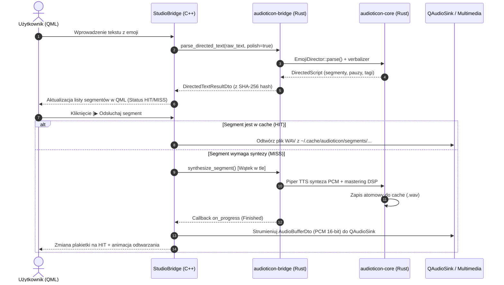

# M5 — Specyfikacja układu UI Audioticon 2.0 (ASTRA Glass Architecture)

**Data utworzenia:** 2026-11-18  
**Autor:** Antigravity (Architektura UI/UX)  
**Status:** Specyfikacja bazowa dla implementacji interfejsu Audioticon 2.0  
**Repozytoria odniesienia:**  
- Baza UI: [`/home/jaro/.openclaw/workspace/AUDIOTICON 2.0/ui`](file:///home/jaro/.openclaw/workspace/AUDIOTICON%202.0/ui)  
- Szablon ASTRA: [`/home/jaro/.openclaw/workspace/ASTRA-UI-Template`](file:///home/jaro/.openclaw/workspace/ASTRA-UI-Template)  
- Snapshot E0–E1: [`/home/jaro/.openclaw/workspace/AUDIOTICON 2.0/ASTRA-E0-E1-SNAPSHOT`](file:///home/jaro/.openclaw/workspace/AUDIOTICON%202.0/ASTRA-E0-E1-SNAPSHOT)

---

## 1. Założenia produktowe i język wizualny

1. **Prawdziwa lokalna aplikacja desktopowa Qt 6 / QML / C++:**
   - Wykluczenie architektury webowej, Electrona, Tauri oraz serwera aplikacji HTTP.
   - Całość uruchamiana w pojedynczym procesie natywnym (`astra-agent-console` / `audioticon-studio`).
2. **Język stylistyczny ASTRA Glass:**
   - Ciemna paleta barw z głębokimi półprzezroczystymi tłami (`Qt.rgba(.018, .035, .055, glass)`).
   - Neonowe akcenty dynamiczne (`feed.accent`, domyślnie szmaragd `#31f7a5` lub błękit odsłuchu `#588bff`).
   - Zaokrąglenia kart (`radius: 16` do `22`), obrysy szkła `#1e3a43` / `#31444d`, tło z siatką kropkową `Canvas` (dot grid).
3. **Ergonomia trójstrefowa:**
   - **Lewa strona:** pionowa szyna nawigacyjna (Nav Rail) przełączająca moduły systemowe.
   - **Centrum:** aktywny obszar roboczy (Studio reżyserii lub Czat AI).
   - **Prawa strona:** kontekstowy inspektor / szuflada narzędziowa (Context Drawer).
   - **Dół:** wspólny pasek stanu i telemetrii (`StateStrip`).

---

## 2. Architektura układu okna (Window Layout)

```
┌─────────────────────────────────────────────────────────────────────────────────────────────────────┐
│ NAGŁÓWEK: [Λ AUDIOTICON 2.0]  [PROJEKT: Wiedzmin_Ch1]   [ZEGAR]  [GŁOS: pl_bass]  [DRAWER ☰]  [⚙]  │
├───────┬─────────────────────────────────────────────────────────────┬───────────────────────────────┤
│ LEWA  │ CENTRALNY OBSZAR ROBOCZY (Dynamiczny Loader)                │ PRAWY PANEL KONTEKSTOWY       │
│ SZYNA │                                                             │ (Drawer / Inspector)          │
│       │ Tryb: STUDIO                                                │                               │
│ [🎙️]  │ ┌─────────────────────────────────────────────────────────┐ │ [TAB: Inspektor segmentu]     │
│Studio │ │ EDYTOR REŻYSERII EMOJI (Directive Composer)             │ │ • Hash: c4f8... (Cache HIT)   │
│       │ │ "📖 Rozdział 1 🛑 Wtedy lektor rzekł... 🐢"            │ │ • Prędkość: 1.15x             │
│ [💬]  │ └─────────────────────────────────────────────────────────┘ │ • Filtr: 📻 radio (DSP)       │
│ Czat  │ ┌─────────────────────────────────────────────────────────┐ │ • Pauza: 900 ms              │
│       │ │ TIMELINE / LISTA SEGMENTÓW                              │ │ • Podgląd Waveformu           │
│ [👥]  │ │ [0] "Rozdział 1"         (Ch)    HIT   [▶]              │ │ ───────────────────────────── │
│ Głosy │ │ [1] "Wtedy lektor rzekł" (Norm)  MISS  [▶]              │ │ [TAB: Kolejka renderu (3)]    │
│       │ │ [2] "cicho i powoli"     (LoFi)  HIT   [▶]              │ │ • Segment 2/8 (45%) [Cancel]  │
│ [📁]  │ └─────────────────────────────────────────────────────────┘ │ ───────────────────────────── │
│ Pliki │ ┌─────────────────────────────────────────────────────────┐ │ [TAB: Ustawienia / Modele]    │
│       │ │ TRANSPORT BAR: [⏮] [▶ Graj] [⏸] [⏭]  00:14 / 03:42      │ │ • Piper ONNX pl_bass (114 MB)│
│ [📊]  │ └─────────────────────────────────────────────────────────┘ │ • Bufor: 22 050 Hz PCM 16-bit │
│ Ledger│                                                             │ • [📌 Przypnij] [✕ Zamknij]   │
├───────┴─────────────────────────────────────────────────────────────┴───────────────────────────────┤
│ DOLNY PASEK STANU (StateStrip): [Cache: 84% 1.4GB]  [Silnik: Piper Ready]  [LUFS: -19.2]  [RAM: 420MB]│
└─────────────────────────────────────────────────────────────────────────────────────────────────────┘
```

---

## 3. Lista modułów lewej nawigacji (Nav Rail)

Lewa szyna nawigacyjna (`NavRail.qml`) zawiera stały zestaw ikon z plakietkami statusu:

| Identyfikator | Ikona | Etykieta | Rola i zachowanie |
|---|:---:|---|---|
| `studio` | 🎙️ | **Studio** | **Główny warsztat produkcyjny.** Edytor tekstu z podświetlaniem gramatyki emoji, dynamiczna lista segmentów, status cache, timeline audio i transport bar. |
| `agent` | 💬 | **Czat AI** | **Konsola asystenta (ASTRA Agent).** Wielo-wątkowy czat z lokalnymi modelami LLM (wariant A). Zawiera akcję przekazania wygenerowanego tekstu do Studia. |
| `voicelab` | 👥 | **VoiceLab** | **Profile lektorskie.** Zarządzanie głosami Piper ONNX, odsłuch próbek, konfiguracja domyślnych narratorów i ról postaci. |
| `projects` | 📁 | **Projekty** | **Biblioteka materiałów.** Spis treści książki, import EPUB / DOCX / Markdown, zarządzanie rozdziałami i strukturą scenariusza. |
| `sfx` | 🔊 | **Foley & SFX** | **Efekty dźwiękowe i otoczenie.** Biblioteka podkładów tła (`🌲`), odgłosów (`🔊`), zarządzanie głośnością i crossfade'em. |
| `ledger` | 📊 | **ACX Ledger** | **Pomiary i mastering.** Analizator poziomów EBU R128 / ACX (Integrated LUFS -23..-18, True Peak < -3dBFS, Noise Floor < -60dBFS). |

---

## 4. Zachowanie centralnego obszaru dla każdego modułu

Centralna przestrzeń wykorzystuje komponent `StackLayout` lub dynamiczny `Loader`:

### 4.1 Moduł `studio` (Centralny Warsztat Reżyserski)
- **Strefa A (Górna - 40% wysokości):** `DirectiveComposer.qml`
  - Wieloliniowe pole edycyjne z natychmiastowym sprawdzaniem składni.
  - Pasek szybkiego wstawiania dyrektyw (Emoji Palette): `📖 Rozdział`, `🛑 Stop 900ms`, `⏸️ Pauza 400ms`, `😮‍💨 Oddech`, `🐢 Zwolnij`, `🐇 Przyspiesz`, `📻 Radio`, `📱 Telefon`, `🏛️ Katedra`, `🤫 Szept`.
  - Przycisk akcji głównej: **„Syntetyzuj cały rozdział”** oraz wskaźnik liczby słów i szacowanego czasu trwania.
- **Strefa B (Środkowa - 48% wysokości):** `SegmentTimelineView.qml`
  - Lista poszczególnych zdań wyodrębnionych przez `parseDirectedText`.
  - Każdy wiersz prezentuje: indeks, tekst znormalizowany, czas trwania, modyfikatory tempo/DSP oraz stan pamięci podręcznej (**Zielona plakietka `HIT`** lub **Szara `MISS`**).
  - Przycisk bezpośredniego odsłuchu pojedynczego zdania (odtwarzanie z cache lub synteza w locie).
- **Strefa C (Dolna - 12% wysokości):** `TransportBar.qml`
  - Przyciski kontroli odtwarzania: `Graj od początku`, `Poprzedni segment`, `Play / Pause`, `Następny segment`.
  - Suwak pozycji (Scrubber) z podziałem na segmenty i znaczniki rozdziałów.
  - Wyświetlacz czasu: czas bieżący / czas całkowity audio.

### 4.2 Moduł `agent` (Czat Asystenta Reżyserii)
- Zachowuje istniejącą architekturę `AgentMain.qml`:
  - `ListView` z delegatami `ChatBubble.qml`.
  - Kompozytor promptów na dole z obsługą streamowania tokenów i przyciskiem `Stop / Send`.
  - Dymki asystenta zawierają dedykowany przycisk: **„🎙️ Przeczytaj w studiu”** (patrz §8).

### 4.3 Moduły `voicelab`, `projects`, `sfx`, `ledger`
- Karty w układzie Grid/List oparte na komponentach Glass Container (`Rectangle` z `feed.glass` i obrysem `#1e3a43`).
- Wspólny nagłówek z filtrami, wyszukiwarką i przyciskami importu/eksportu.

---

## 5. Struktura prawego panelu kontekstowego (Context Drawer)

Prawy panel jest uniwersalnym kontenerem (`ContextInspector.qml`) o szerokości **320 px**, posiadającym nagłówek z selektorem zakładek oraz przyciskami przypięcia (`Pin`) i zamknięcia (`Close`).

Panel grupuje 7 wyspecjalizowanych widoków:

```
┌────────────────────────────────────────────────────────┐
│ [PRAWY PANEL]                [📌 Pin]  [⤢ Dock]  [✕]    │
│ TABS: [Inspektor] [Kolejka] [Głosy] [Materiały] [Więcej▾]│
├────────────────────────────────────────────────────────┤
│ ZAKŁADKA 1: INSPEKTOR SEGMENTU (Segment Inspector)     │
│ • Segment ID: #14 (Rozdział 2, zdanie 3)               │
│ • SHA-256 Hash: e7a1b092... [Kopiuj]                   │
│ • Status Cache: TRAFIONY (WAV 48.2 KB, 1.42s)          │
│ • Modyfikator tempa: x1.15 (🐇 Szybko)                 │
│ • Filtr akustyczny: Cathedral (Pojemność 1.8s)         │
│ • Pauza końcowa: 400 ms                                │
│ • Wykres szczytów:  ▂▃▅▆▇▆▅▃▂                          │
│ [▶ Odsłuchaj próbkę]  [🔄 Przelicz na nowo]            │
├────────────────────────────────────────────────────────┤
│ ZAKŁADKA 2: KOLEJKA ZADAŃ (Task Queue)                 │
│ • Aktywne: Rozdział 1 - Renderowanie (Krok 18/42)      │
│   Postęp: [████████████░░░░░░░░░░] 42% (ETA: 14s)      │
│ • W kolejce: Eksport M4B - Wiedzmin                    │
│ [Anuluj bieżące]  [Wyczyść zakończone]                 │
├────────────────────────────────────────────────────────┤
│ ZAKŁADKA 3: MODELE I GŁOSY (Model Catalog)             │
│ • Aktywny głos: pl_PL-darkman-medium (Piper ONNX)      │
│ • Dostępne głosy lokalne:                              │
│   - pl_PL-gosia-medium (22kHz, Apache-2.0) [Wybierz]   │
│   - pl_PL-bass (114 MB, Apache-2.0) [Aktywny]          │
│ • [Pobierz nowe głosy z katalogu...]                   │
├────────────────────────────────────────────────────────┤
│ ZAKŁADKA 4: PROJEKTY I MATERIAŁY (Source Assets)       │
│ • Importowany dokument: ksiazka.epub (14 rozdziałów)   │
│ • Pokrycie reżyserią: 92% tekstu wyreżyserowane        │
│ • Pliki robocze: project.audioticon                    │
├────────────────────────────────────────────────────────┤
│ ZAKŁADKA 5: BIBLIOTEKA EKSPORTÓW (Export Vault)        │
│ • Ostatni eksport: Rozdzial_01_Master.m4b (44.1 kHz)   │
│ • Tagi: Autor, Tytuł, Okładka embedded, Rozdziały AAC  │
│ [Otwórz folder docelowy]  [Eksportuj do MP3]           │
├────────────────────────────────────────────────────────┤
│ ZAKŁADKA 6: USTAWIENIA (Settings)                      │
│ • Ścieżka cache XDG: ~/.cache/audioticon/segments      │
│ • Maksymalny rozmiar cache: [ 2.0 GB ] [Wyczyść LRU]   │
│ • Motyw: Akcent szmaragdowy, Glass 85%                 │
├────────────────────────────────────────────────────────┤
│ ZAKŁADKA 7: DIAGNOSTYKA (Doctor / Telemetry)           │
│ • Silnik syntezy: ONNX Runtime 1.24 (Natywny CPU/AVX2) │
│ • ffmpeg: v7.1 (Zainstalowany)                         │
│ • Wolna pamięć RAM: 14.2 GB / VRAM: N/A                │
└────────────────────────────────────────────────────────┘
```

---

## 6. Sposób otwierania, przypinania i zamykania prawego panelu

Prawy panel obsługuje dwa tryby pracy w zależności od preferencji użytkownika i rozmiaru okna:

```
[TRYB DOCKED / PRZYPIĘTY]                [TRYB OVERLAY DRAWER / PŁYWAJĄCY]
┌────────┬─────────────┬─────────┐       ┌────────┬──────────────────────┐
│  Nav   │   Obszar    │  Prawy  │       │  Nav   │        Obszar        │
│  Rail  │   Roboczy   │  Panel  │       │  Rail  │        Roboczy       │
│ (56px) │ (Elastyczny)│ (320px) │       │ (56px) │ (Pełna szerokość)    │
│        │             │ [📌 Pin]│       │        │        ┌─────────────┤
│        │ Treść       │ Treść   │       │        │ Treść  │ Szuflada    │
│        │ dostosowuje │ Dok     │       │        │ pod    │ nakłada się │
│        │ szerokość   │         │       │        │ spodem │ cieniem     │
└────────┴─────────────┴─────────┘       └────────┴────────┴─────────────┘
```

1. **Tryb Pinned (Dok):**
   - Panel zajmuje stałą kolumnę w głównym `RowLayout`.
   - Obszar centralny płynnie zmniejsza swoją szerokość.
   - Stan jest zapamiętywany w `QSettings` (`inspectorPinned = true`).
2. **Tryb Drawer (Szuflada nakładana):**
   - Panel wysuwa się animacją z prawej krawędzi okna (`x: parent.width - width`).
   - Rzuca półprzezroczysty cień na obszar centralny.
   - Kliknięcie w tło obszaru roboczego lub naciśnięcie klawisza `Esc` natychmiast zamyka szufladę.
3. **Sterowanie i skróty:**
   - Przycisk `[☰ Panel]` na pasku nagłówka przełącza widoczność panelu.
   - Kliknięcie dowolnego segmentu w widoku Studia automatycznie otwiera prawy panel w zakładce **Inspektor**.
   - Skrót klawiszowy `Ctrl+I`: otwiera/zamyka inspektora.
   - Skrót klawiszowy `Ctrl+J`: otwiera kolejkę zadań.
   - Przycisk pinezki `[📌]`: przełącza między trybem Overlay a Docked.

---

## 7. Responsywność dla małych okien (Breakpoints)

Aplikacja posiada zdefiniowane minimalne wymiary okna: `minimumWidth: 780; minimumHeight: 560`.

| Szerokość okna | Lewa szyna (Nav Rail) | Prawy panel (Drawer) | Dolny StateStrip |
|---|---|---|---|
| **Szerokie (> 1180 px)** | Pełna szyna z etykietami (szerokość 180 px) | Tryb Docked (przypięty, 320 px) lub Overlay | Pełna wysokość (136 px), wszystkie wykresy |
| **Średnie (900 – 1180 px)** | Szyna zwinięta: tylko ikony (szerokość 56 px) | Domyślnie zwinięty; otwiera się jako Overlay Drawer | Kompaktowy pasek (wysokość 48 px) |
| **Kompaktowe (780 – 900 px)**| Szyna zwinięta (56 px) z tooltipami | Wyłącznie jako Overlay Drawer (zasłaniający centrum) | Ukryty lub zredukowany do jednolinijkowego statusu |

---

## 8. Przepływ: tekst → parser → render → cache → odsłuch

Architektura gwarantuje pełną interaktywność i brak blokowania GUI:



---

## 9. Przepływ czatu: wiadomość → „Przeczytaj w studiu”

Funkcja łączy moduł konwersacyjny asystenta ASTRA z modułem produkcyjnym Studia:

```
┌────────────────────────────────────────────────────────────────────────┐
│ MODUŁ CZATU: ChatBubble (Odpowiedź asystenta)                          │
│ ┌────────────────────────────────────────────────────────────────────┐ │
│ │ "Oto wyreżyserowana scena z odpowiednimi pauzami:                  │ │
│ │  📖 Rozdział I. 🛑 Noc była chłodna. 😮‍💨 Głos zamarł w oddali... 🐢"│ │
│ │                                                                    │ │
│ │  [📋 Kopiuj]    [🎙️ Przeczytaj w studiu]                           │ │
│ └────────────────────────────────────────────────────────────────────┘ │
└───────────────────────────────────┬────────────────────────────────────┘
                                    │ Kliknięcie przycisku
                                    ▼
┌────────────────────────────────────────────────────────────────────────┐
│ AKCJA W KONTROLERZE GŁÓWNYM (AppController / Main.qml):                │
│ 1. Pobranie tekstu wiadomości: textToStudio = message.body             │
│ 2. Przełączenie aktywnego modułu: currentModule = "studio"             │
│ 3. Przekazanie tekstu do edytora: studioBridge.parseDirectedText(text) │
│ 4. Wyświetlenie powiadomienia Toast: "Wczytano 4 segmenty do Studia"   │
└────────────────────────────────────────────────────────────────────────┘
```

---

## 10. Kontrakt QML bez łamania istniejącego ASTRA AgentModel

Aby nie zepsuć dotychczasowego kodu ASTRA i zachować zgodność z 17 przechodzącymi testami QtTest:

### 10.1 Zasada separacji kontekstów
Obiekty zarejestrowane w `QQmlApplicationEngine`:
- `feed` (`AgentModel*`) — pozostaje nienaruszony. Wszystkie jego właściwości (`model`, `messages`, `sessions`, `tools`, `contextUsed`, `strip`, `accent`, `glass`) działają dokładnie tak jak dotychczas.
- `i18n` (`Translator*`) — obsługuje tłumaczenia interfejsu (pl/en).
- `studio` (`StudioBridge*`) — **nowy obiekt kontekstowy** zarządzający logiką reżyserii audio, segmentami, odtwarzaniem i inspektorem.

### 10.2 Struktura korzenia QML (`AppShell.qml` / `AgentMain.qml`)
```qml
ApplicationWindow {
    id: win
    // Dostęp do właściwości stylu przez 'feed' (kompatybilność wsteczna)
    property color accent: feed.accent
    property double glass: feed.glass
    property string activeModule: "studio" // "studio" | "agent" | "voicelab" | "projects"

    RowLayout {
        anchors.fill: parent

        // 1. Lewa szyna nawigacyjna
        NavRail {
            currentModule: win.activeModule
            onModuleSelected: (mod) => win.activeModule = mod
        }

        // 2. Centralny obszar roboczy (przełączany stanem)
        StackLayout {
            Layout.fillWidth: true
            Layout.fillHeight: true
            currentIndex: win.activeModule === "studio" ? 0 : 1

            StudioView { id: studioView }
            AgentView  { id: agentView } // Zawiera transcriptView wymagany przez testy!
        }

        // 3. Prawy panel kontekstowy (Drawer / Docked Inspector)
        ContextInspector {
            id: rightPanel
            pinned: true
            currentTab: studioView.selectedSegmentIndex >= 0 ? "inspector" : "queue"
        }
    }

    // 4. Dolny pasek stanu
    StateStrip {
        s: feed.strip
    }
}
```

Dzięki temu `Tests::agentTurnStreamsAndShowsTools()` oraz `Tests::agentConsoleRenders()` odnajdują obiekt `transcriptView` w hierarchii i przechodzą bez jakichkolwiek modyfikacji.

---

## 11. Minimalny zestaw widoków dla pierwszego MVP (Vertical Slice)

Do zrealizowania pierwszego w pełni działającego wydania MVP (wycinek pionowy: **Tekst → Emoji → Piper → Cache → Playback**) wymagane są wyłącznie **3 nowe pliki QML**:

1. `src/qml/StudioView.qml`:
   - Górny edytor tekstu podpięty do `studio.parseDirectedText(text)`.
   - Środkowa lista segmentów z kolorowymi badge'ami `HIT / MISS`.
   - Przyciski pojedynczego odsłuchu `[▶]` wywołujące `studio.playSegment(index)`.
2. `src/qml/NavRail.qml`:
   - Pionowy pasek ikon: przełącznik `Studio` ↔ `Czat Asystenta`.
3. `src/qml/ContextInspector.qml`:
   - Zakładka szczegółów zaznaczonego zdania (SHA-256 hash, tempo, filtr DSP).
   - Zakładka kolejki renderowania z paskiem postępu `studio.taskPercent`.

Pozostałe moduły (`VoiceLab`, `Foley`, `ACX Ledger`) w etapie MVP prezentują elegancką kartę informacyjną *„Moduł w przygotowaniu — dostępny w M6”*, co pozwala zachować czystość kodu bez przedwczesnego rozbudowywania nieprzetestowanych komponentów.

---

## 12. Podsumowanie decyzji projektowych

1. **Brak webu:** 100% natywny QML z kompilacją qmake6 / CMake.
2. **Spójność wizualna:** Pełne zachowanie tożsamości szklanego interfejsu ASTRA (Glass UI, akcenty `#31f7a5`, czcionki monospace dla telemetrii).
3. **Niezawodność:** Separacja danych sesji agenta (`feed`) od silnika audio (`studio`), gwarantująca pełną zgodność z istniejącymi testami jednostkowymi.
4. **Ergonomia:** Płynne przejście z czatu tekstowego do studia za pomocą jednego kliknięcia (`„Przeczytaj w studiu”`).
