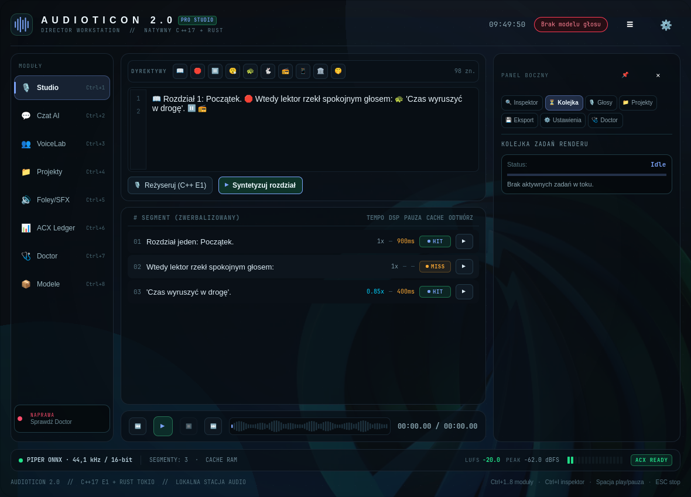
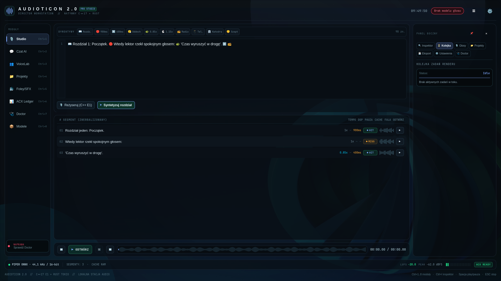
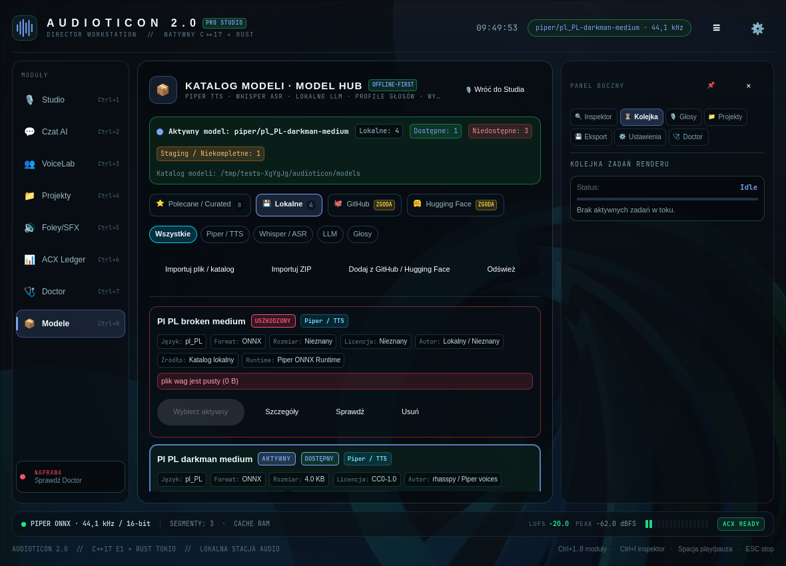
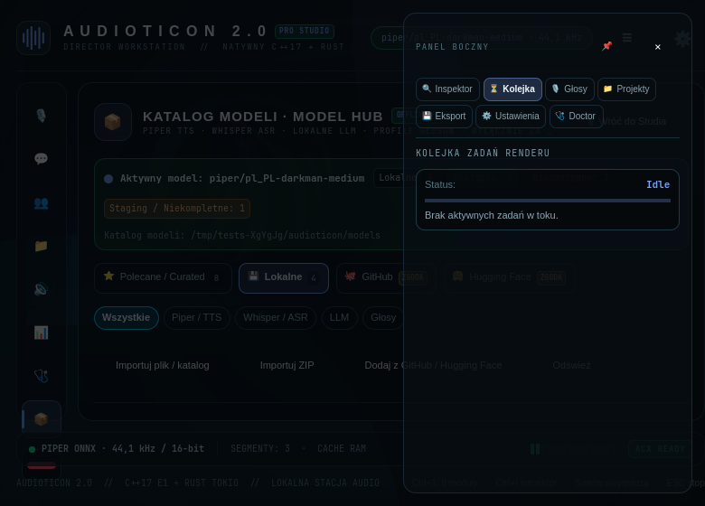
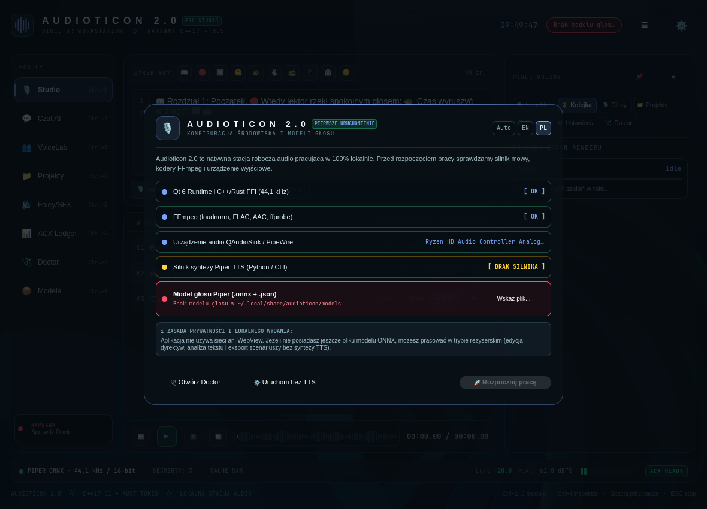

<div align="center">

# Audioticon 2.0

### Local-First Audiobook Directing, Speech Synthesis & Audio Mastering Workstation

[](https://github.com/jarohull-ai/AUDIOTICON-2.0/actions/workflows/ci.yml)
[](LICENSE)
[](backend/)
[](ui/)
[-lightgrey.svg?logo=linux)]()
[]()
[](M19_MODEL_HUB_UI.md)

<p align="center">
  <a href="#about-audioticon-20">About</a> •
  <a href="#screenshot-gallery">Gallery</a> •
  <a href="#feature-matrix">Feature Matrix</a> •
  <a href="#system-requirements">Requirements</a> •
  <a href="#quick-start--build">Build</a> •
  <a href="#model-management--model-hub">Model Hub</a> •
  <a href="#security--offline-guarantees">Security</a> •
  <a href="#documentation--wiki">Wiki</a>
</p>

</div>

---

## About Audioticon 2.0

**Audioticon 2.0** is an open-source, local-first Linux workstation engineered for audiobook producers, sound designers, voice narrators, and audio drama creators. It unifies professional script verbalization, multi-voice neural text-to-speech, real-time playback, audio mastering, and offline machine learning model management into a fluid desktop application.

### The Transplant Philosophy

Audioticon 1.x originated as a web-based prototype. While useful for rapid exploration, browser-based audio tools suffer from fundamental architectural flaws: heavy WebViews, unpredictable Garbage Collection audio dropouts, Node.js background HTTP server vulnerabilities, and lack of deterministic memory control.

**Audioticon 2.0 is a complete, native ground-up transplant:**
- **Domain Engine (Rust):** High-performance task registry, audio DSP pipelines, multi-track normalization, file format parsers, and XDG model catalog scanning.
- **Presentation Layer (C++17 + Qt 6 Quick):** Smooth, 60fps liquid-glass user interface, dynamic window scaling, low-latency audio playback, and responsive controls.
- **Zero Web Runtime:** **No HTTP server daemons**, **no WebViews (`QWebEngineView`)**, **no Electron**, and **no silent cloud telemetry**. Everything runs directly on your hardware.

---

## Screenshot Gallery

### 1. Director Workstation Canvas

The primary workspace integrates the left vertical navigation rail (`NavRail`), the central directive editor timeline (`StudioView`), and the dockable context inspector (`ContextInspector`).

#### Desktop Default (`1180 × 850`)

*Figure 1: Default Director Workstation layout showing the active script timeline, directive tags, dockable context inspector, and mastering footer.*

<details>
<summary><b>View Additional Resolutions (Compact 780×560 & Full HD 1920×1080)</b></summary>

#### Compact Window (`780 × 560` — Minimum Supported Resolution)

*Figure 2: Compact breakpoint layout with collapsed 56px NavRail, wrapped action toolbars, and overlay drawer with modal scrim.*

#### Full HD Display (`1920 × 1080`)

*Figure 3: Widescreen Full HD view offering generous breathing room, expanded timeline segments, and persistent side panels.*

</details>

---

### 2. Model Hub & Offline Model Catalog (Milestone M19)

The native **Model Hub** (`Ctrl+8`) manages neural voice models (Piper), transcription engines (Whisper), and local language models (LLM) across local, curated, and remote sources.

#### Model Hub Local View (`1180 × 850`)

*Figure 4: Model Hub displaying installed local models with state badges (`AVAILABLE`, `CORRUPT`, `MISSING METADATA`, `INCOMPLETE`), runtime requirements, and action buttons.*

<details>
<summary><b>View Additional Resolutions (780×560 & 1920×1080)</b></summary>

#### Model Hub Compact (`780 × 560`)

*Figure 5: Model Hub on a 780×560 display demonstrating zero text clipping and responsive wrapping of filter chips and action rows.*

#### Model Hub Widescreen (`1920 × 1080`)

*Figure 6: Full HD overview of the catalog showing curated presets alongside local models.*

</details>

---

### 3. Explicit Remote Download Consent (Glass Modal)

Audioticon 2.0 enforces a strict security policy: **no network sockets are opened without explicit user consent**.


*Figure 7: Transparent Glass modal requiring manual confirmation of author, license, byte size, file URLs, and checksums before downloading from GitHub Releases or Hugging Face.*

---

### 4. First Run Wizard & Environment Diagnostics

First-time onboarding checks local dependencies (`piper`, `ffmpeg`, `sox`, `espeak-ng`) and assists in setting up speech models.

#### First Run Onboarding (`1180 × 850`)

*Figure 8: Initial setup screen with instant language selection (`PL` / `EN`), environment diagnostics check, and non-TTS director mode toggle.*

<details>
<summary><b>View Additional Resolutions (780×560 & 1920×1080)</b></summary>

#### First Run Compact (`780 × 560`)

*Figure 9: Guaranteed accessible action buttons and scrollable diagnostic card at minimum resolution.*

#### First Run Full HD (`1920 × 1080`)

*Figure 10: First Run Wizard on a high-resolution display.*

</details>

---

## Feature Matrix

Audioticon 2.0 practices transparent architectural communication. The table below distinguishes between fully operational code, backend foundations, and planned modules.

| Capability / Module | Status | Tier | Notes & Implementation Details |
|---|---|---|---|
| **Safe Rust ↔ Qt FFI Bridge** | **Implemented** | Core | Memory-safe typed DTO boundary via `cxx`. Zero raw pointer leaks. |
| **Director Workstation UI** | **Implemented** | UI | Qt Quick Controls 2, responsive layout across 780/1180/1920px. |
| **First Run & Doctor UX** | **Implemented** | Diagnostics | 100% offline dependency probe (`piper`, `ffmpeg`, `sox`, XDG paths). |
| **Full Internationalization** | **Implemented** | Core | Complete Polish and English coverage (**503 / 503 keys**). |
| **Liquid Glass & Wallpapers** | **Implemented** | Visual | Unified opacity parameter, static/video backdrops, asset fallback. |
| **Piper Neural TTS** | **Implemented** | Audio | Multi-threaded synthesis, WAV normalization, and directive verbalizer. |
| **Audio Playback Engine** | **Implemented** | Audio | Low-latency non-blocking stream player based on `QAudioSink`. |
| **Model Catalog (Model Hub)** | **Implemented** | Core / UI | XDG scanner, curated presets, atomic staging, corrupt model detection. |
| **Explicit Consent Gate** | **Implemented** | Security | Checkbox-guarded modal for on-demand remote downloads (GitHub / HF). |
| **TTS Speech Parameters** | *In Progress* | Audio / UI | Dynamic rate, pitch, volume sliders and cache hash integration. |
| **Custom Directives (TOML)** | *Planned* | Audio | User-defined emoji directives in `audioticon.toml` synced to C++ parser. |
| **VoiceLab (Character Cast)** | *Planned* | Studio | Speaker assignment to characters (currently UI navigation placeholder). |
| **Whisper ASR Transcription** | *Planned* | Speech | Local `whisper.cpp` transcription (Model Hub catalog ready; runtime planned). |
| **Local LLM Script Directing** | *Planned* | Directing | Quantized GGUF directive generator (Model Hub ready; runtime planned). |
| **Projects / Foley / ACX** | *Planned* | Studio | Workflow modules (currently UI navigation placeholders). |
| **Final Visual Polish** | *Planned* | Visual | Fable / Hydrogen / Carbon palette pass (frozen until P1 logic completes). |

---

## System Requirements

### Hardware Requirements
- **CPU:** x86_64 processor with AVX2 instruction support (Intel Core 4th Gen+, AMD Ryzen).
- **RAM:** 4 GB minimum (8 GB+ recommended for running long audiobook chapters and local LLMs).
- **Storage:** 500 MB for application and build; 2 GB to 10 GB for neural voice models.
- **Audio Output:** ALSA, PulseAudio, or PipeWire compatible sound card.

### Supported Operating Systems
- **Arch Linux / Omarchy** (Rolling release)
- **Ubuntu 22.04 LTS / 24.04 LTS**
- **Debian 12 (Bookworm)**
- **Fedora 39 / 40**

---

## Quick Start & Build

Audioticon 2.0 compiles with standard Linux development tools.

### 1. Install Dependencies

#### Ubuntu 24.04 / Debian 12:
```bash
sudo apt-get update
sudo apt-get install -y build-essential curl pkg-config \
  qt6-base-dev qt6-declarative-dev qt6-multimedia-dev libgl1-mesa-dev libglx-dev \
  ffmpeg sox libsox-fmt-all espeak-ng
```

#### Arch Linux:
```bash
sudo pacman -S --needed base-devel rust qt6-base qt6-declarative qt6-multimedia \
  qt6-quickcontrols2 ffmpeg sox espeak-ng
```

### 2. Compile from Source

```bash
# Clone the repository
git clone https://github.com/jarohull-ai/AUDIOTICON-2.0.git
cd AUDIOTICON-2.0

# Build the Rust bridge static library
cd backend
cargo build --release --package audioticon-bridge
cd ..

# Build the Qt Quick application
mkdir -p ui/build-console
cd ui/build-console
qmake6 ../agent-console.pro
make -j$(nproc)
cd ../..
```

### 3. Launch the Workstation

```bash
./ui/build-console/astra-agent-console
```
*(On Wayland compositors, run with `QT_QPA_PLATFORM=wayland ./ui/build-console/astra-agent-console`)*

---

## Test Instructions

Audioticon 2.0 maintains a dual-tier testing methodology ensuring complete stability:

```bash
# 1. Run all 221 Rust backend tests (catalog, staging, bridge, audio)
cd backend
cargo test --workspace --verbose

# 2. Build and run all 40 Qt tests (offscreen QPA, layout, i18n, Model Hub)
cd ../ui
mkdir -p build-tests && cd build-tests
qmake6 ../tests/tests.pro
make -j$(nproc)
QT_QPA_PLATFORM=offscreen QT_QUICK_BACKEND=software ./tests
```

Both test suites execute 100% offline and require no display server.

---

## Model Management & Model Hub

Speech synthesis requires voice models. Models reside strictly under standard XDG paths:

```
~/.local/share/audioticon/models/
├── piper/      # *.onnx + *.onnx.json (Piper TTS models)
├── whisper/    # *.bin (Whisper speech-to-text models)
├── llm/        # *.gguf (Quantized local language models)
└── voices/     # *.json (Character voice profiles)
```

### Curated Models Available in Model Hub:
- **`pl_PL-darkman-medium` (Polish Male, CC0 Public Domain):** Deep, authoritative narration.
- **`pl_PL-gosia-medium` (Polish Female, CC0 Public Domain):** Natural, melodic prose voice.
- **`pl_PL-mc_speech-medium` (Polish Expressive, CC0 Public Domain):** Broad dynamic range.
- **`en_US-amy-medium` (English Female, CC0 Public Domain):** Clear English narration.
- **`en_US-lessac-medium` (English Male, Non-Commercial):** Educational/research model.
- **`whisper/ggml-base` & `whisper/ggml-small` (MIT):** Local speech recognition.
- **`llm/qwen2.5-3b-instruct-q4` (Apache-2.0):** Quantized directing assistant.

---

## Security & Offline Guarantees

1. **No Silent Network Access:** The application will never initiate a network connection on launch or in the background.
2. **Explicit Consent Barrier:** Downloading from GitHub Releases or Hugging Face triggers a transparent modal requiring explicit user confirmation of the author, license, file list, byte size, and SHA-256 hash.
3. **Atomic Staging:** Incoming assets are extracted into `.staging/<import-id>/` and validated before being moved to permanent paths.
4. **Archive Sanitization:** ZIP imports strictly disallow path traversal (`../`), symbolic links, and executable script extensions (`.exe`, `.so`, `.sh`, `.py`, `.js`).

---

## Documentation & Wiki

Comprehensive documentation is available in our [GitHub Wiki](docs/wiki/Home.md):

* **[Wiki Home](docs/wiki/Home.md)** — Documentation overview and sitemap.
* **[Architecture](docs/wiki/Architecture.md)** — In-depth breakdown of Rust domain core and Qt Quick layers.
* **[Director Workstation UX](docs/wiki/Director-Workstation-UX.md)** — Layout rules, liquid glass, and breakpoint matrix.
* **[Build Guide](docs/wiki/Build-Guide.md)** — Detailed compilation instructions and distro packages.
* **[Development Setup](docs/wiki/Development-Setup.md)** — Coding standards, git conventions, and translation tools.
* **[Testing](docs/wiki/Testing.md)** — Unit, regression, and offscreen test coverage details.
* **[Model Hub](docs/wiki/Model-Hub.md)** — Model statuses, import flows, and catalog structure.
* **[Model Import Security](docs/wiki/Model-Import-Security.md)** — Defense against archive exploits and network consent details.
* **[Piper TTS](docs/wiki/Piper-TTS.md)** — Neural voice rendering and Polish directive verbalization.
* **[Whisper ASR](docs/wiki/Whisper-ASR.md)** — Planned offline speech recognition design.
* **[Local LLM](docs/wiki/Local-LLM.md)** — Planned local GGUF directing engine.
* **[VoiceLab](docs/wiki/VoiceLab.md)** — Planned character casting studio.
* **[XDG Paths](docs/wiki/XDG-Paths-and-Runtime-Data.md)** — Specification for data, config, and cache files.
* **[Troubleshooting](docs/wiki/Troubleshooting.md)** — Resolving audio output, model missing, or Wayland issues.
* **[Licensing](docs/wiki/Licensing.md)** — Commercial audiobook publishing rights per model.
* **[Roadmap](docs/wiki/Roadmap.md)** — Detailed tracking of completed and planned milestones.
* **[Contributing](CONTRIBUTING.md)** — Guidelines for pull requests and code style.
* **[Security Policy](SECURITY.md)** — Vulnerability reporting instructions and response SLAs.

---

## Limitations

- **Platform Support:** Linux x86_64 only. Windows and macOS builds are not currently supported.
- **Audio Output:** Real-time playback requires a functioning ALSA, PulseAudio, or PipeWire sound subsystem.
- **TTS Parameters:** Dynamic slider control of speech tempo and pitch is in progress (Milestone M20).
- **Inference Runtimes:** Whisper ASR and local LLMs are cataloged in the Model Hub, but runtime audio transcription and script directing are not yet active in this build.

---

## License

Audioticon 2.0 is licensed under the [MIT License](LICENSE).
Backend crates are dual-licensed under [MIT](backend/LICENSE-MIT) and [Apache License 2.0](backend/LICENSE-APACHE).

For third-party components, licenses of dependencies, and commercial rights for specific neural voice models, refer to [THIRD_PARTY_NOTICES.md](THIRD_PARTY_NOTICES.md).
