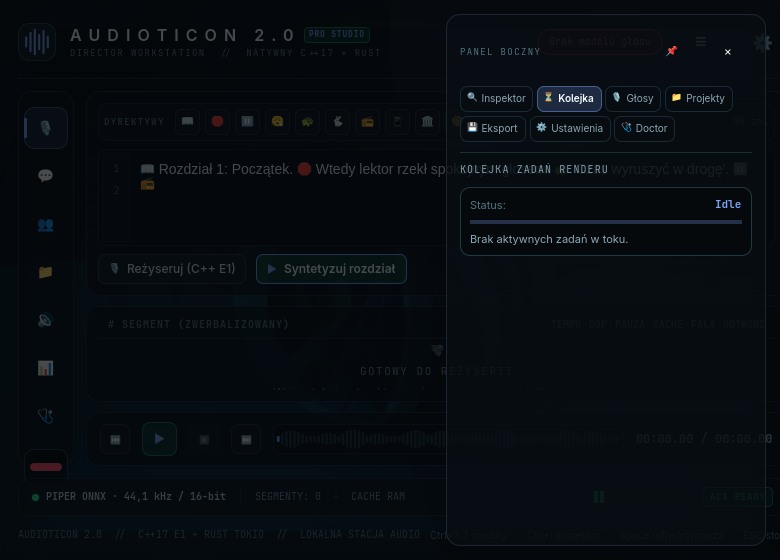
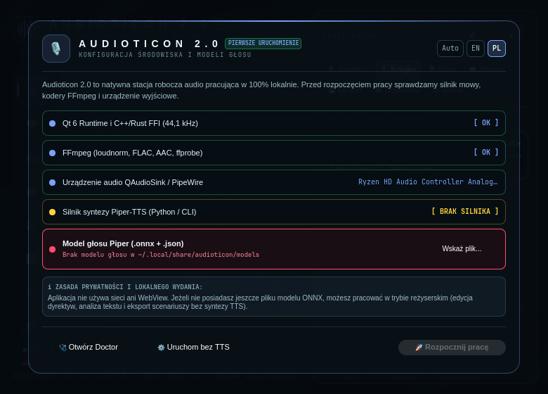
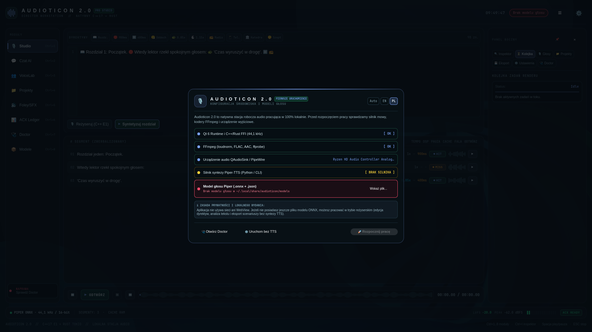
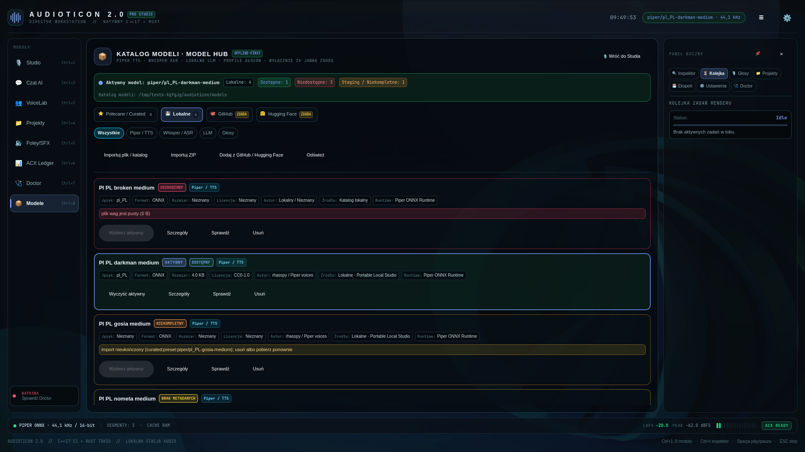
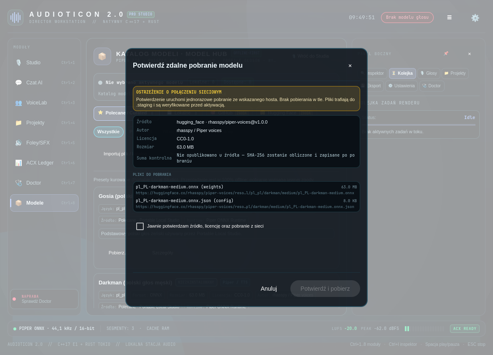

# Audioticon 2.0

> Lokalna stacja robocza do reżyserii audiobooków, syntezy mowy i masteringu audio.

Audioticon 2.0 jest natywną aplikacją desktopową Qt + Rust. Projekt pozostaje lokalny: bez HTTP, WebView, chmury i automatycznego pobierania modeli.

## Stan projektu

- M16 P0: First Run, pełne PL/EN, szkło, tapety i layout Director Workstation
- M17: wspólny katalog modeli oraz kontrakt Rust/C++/Qt FFI
- Rust: 195 testów zaliczonych
- QtTest: 37 testów zaliczonych
- brak commitów produkcyjnych w pierwotnych repozytoriach — ten projekt jest snapshotem roboczym Audioticon 2.0

## Zrzuty ekranu

### Director Workstation

| 780×560 | 1180×850 | 1920×1080 |
|---|---|---|
|  |  |  |

### First Run Wizard

| 780×560 | 1180×850 | 1920×1080 |
|---|---|---|
|  |  |  |

## Budowanie

Wymagania: Rust, Qt 6, qmake6, FFmpeg 9 oraz środowisko systemowe opisane w dokumentacji release.

```bash
cd backend
cargo test --workspace --no-fail-fast

cd ../ui
qmake6 CONFIG+=release
make -j$(nproc)
```

## Dokumentacja etapów

- [M15 — reset kierunku produktu](M15_PRODUCT_DIRECTION_RESET.md)
- [M16 — implementacja P0 UX](M16_P0_UX_IMPLEMENTATION.md)
- [M17 — katalog modeli i FFI](M17_MODEL_CATALOG_FFI.md)
- [Integracja i historia etapów](INTEGRATION_ANALYSIS.md)

## Następne etapy

1. M18 — import lokalnych modeli oraz jawny import z GitHub/Hugging Face
2. M19 — UI katalogu modeli i parametry TTS
3. Whisper/STT, lokalne LLM, VoiceLab i własne głosy
4. finalny visual pass dopiero po zamknięciu funkcji P1.

## Licencja

Kod i zależności są opisane w plikach LICENSE oraz THIRD_PARTY_NOTICES w odpowiednich katalogach.

### Model Hub

| 780×560 | 1180×850 | 1920×1080 |
|---|---|---|
|  |  |  |

Jawny modal zgody dla źródeł zdalnych:


