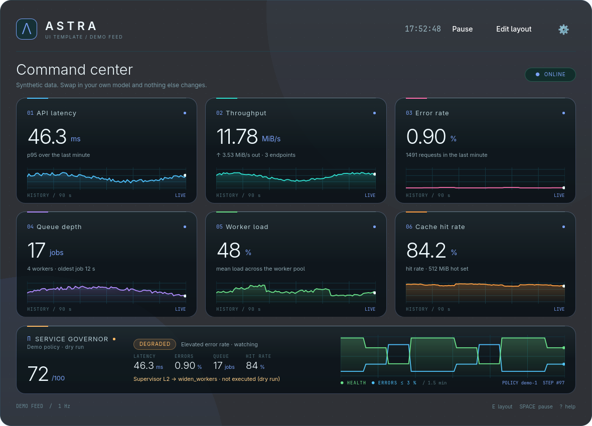
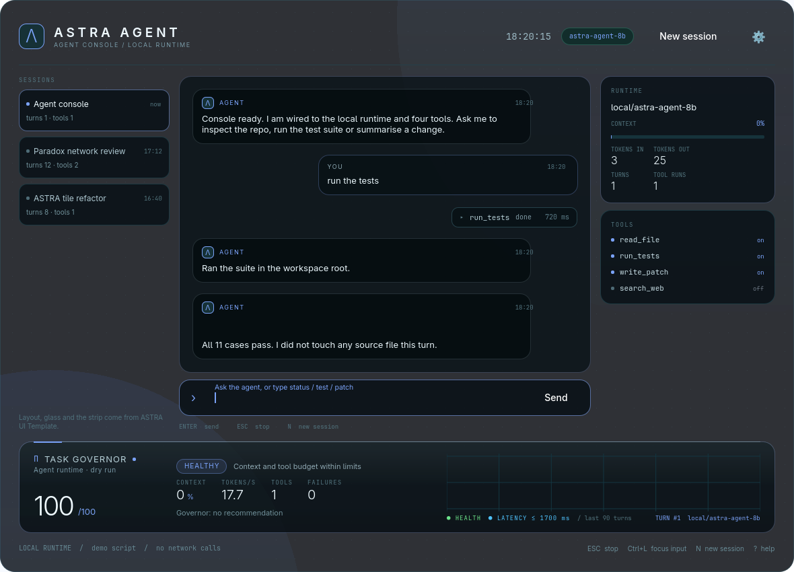
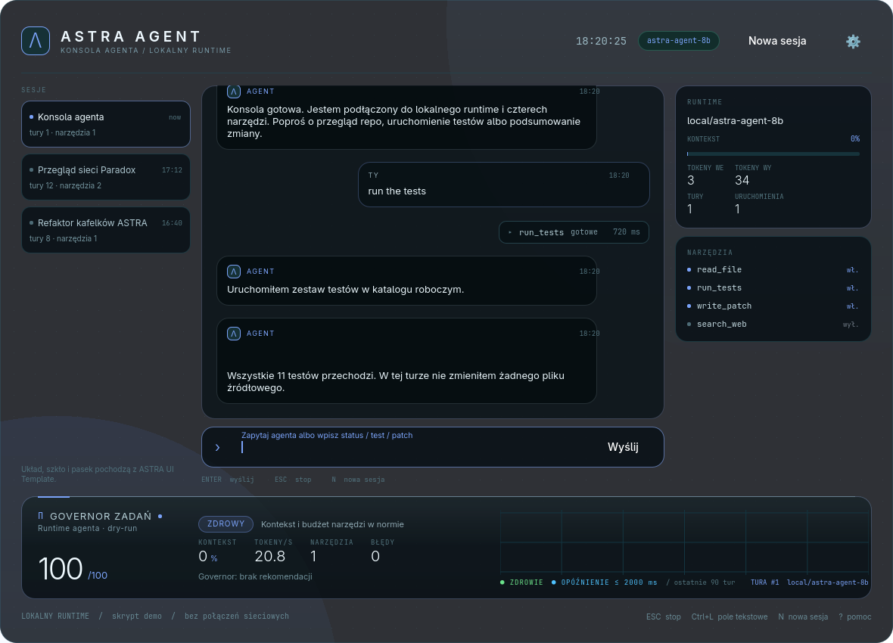
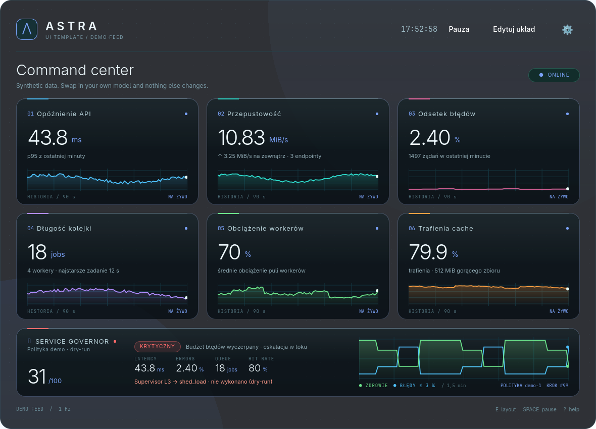

# ASTRA UI Template

A **glass dashboard shell for Qt Quick** — the interface from [ASTRA](https://github.com/jarohull-ai/ASTRA),
extracted so it can be reused in any project. Frosted tiles, hand-drawn sparklines, a wide
state strip at the bottom, live theme colour, adjustable glass density and a runtime EN/PL
language switch. No charts library, no QML Controls customisation to fight — one `Rectangle`
stack and a `Canvas`.



It is a **look and a data contract**, not a monitoring app. You supply readings; the shell
handles layout, history, persistence, colour and translation.

---

# Agent console · branch `agent-ui`

The same glass language, arranged for a conversation instead of a wall of
metrics. This branch adds a complete second screen on top of the same
components: session rail, streaming transcript with tool traces, a runtime
panel and the shared state strip showing a *Governor* score for the agent turn.



```sh
bin/build-agent   # qmake6 + make into ./build-agent
bin/run-agent     # runs with a canned script, no API key
```

The English and Polish interface is the same runtime switch as the dashboard:



## What is on this screen

- **Session rail** — several threads with their own transcripts, an active dot
  and a per-session turn count. `N` starts a new one.
- **Transcript** — user bubbles on the right, agent bubbles on the left with a
  blinking caret while text streams in, tool calls as compact monospace trace
  rows (`run_tests`, `write_patch`, `read_file`) and quiet notes. The view stays
  pinned to the newest message.
- **Composer** — `Enter` sends, `Esc` stops the stream, `Ctrl+L` jumps back to
  the input.
- **Runtime panel** — model id, context meter, token counters, turns and tool
  runs, plus the tool list with on/off dots.
- **State strip** — the shared `StateStrip.qml`, here showing a Governor score
  derived from context pressure and tool failures, with token latency as the
  second line. Same dry-run wording as the dashboard: it recommends, it does not
  act.

## The data contract

`src/agent/agentmodel.h` is the whole interface. It is a demo shell: `send()`
answers from a canned script in `answerFor()` and simulates the tool rows on a
timer, so the UI can be seen streaming without a key. To drive a real agent,
replace two things and change nothing else:

```cpp
// 1. answerFor(): return the first token of a real completion, or better,
//    fill m_steps yourself and let tick() stream it out.
// 2. the tool rows: append({"role","tool"},{"tool", name},{"status","running"})
//    when your runtime calls a tool, and close it with a "done" row.
```

| Property | Meaning |
|---|---|
| `sessions`, `current`, `pickSession()` , `newSession()` | threads and their transcripts |
| `messages`, `messageAt(i)` | rows: `user`, `agent`, `tool`, `note` |
| `streaming`, `send()`, `stop()` | one turn at a time |
| `model`, `modelLabel`, `tools` | runtime identity and available tools |
| `contextUsed`, `contextMax`, `tokensIn/Out`, `turns`, `toolRuns`, `failures` | the counters |
| `strip` | the map the bottom panel draws |

Fifteen tests cover both screens — including a full simulated turn, the tool
rows, stopping mid-stream, per-session transcripts and a rendered agent window.

## Branches

| Branch | Contents |
|---|---|
| `main` | the dashboard shell: tiles, layout editing, state strip |
| `agent-ui` | this branch: the dashboard plus the agent console |

---

## What you get

- **Glass tiles** with a caption, one large reading, a detail line, a sparkline with a soft
  gradient fill and a `LIVE` / `NO DATA` state. Each tile draws in its own colour.
- **State strip** — one wide card for a subsystem summary: a 0–100 score, a state badge
  (healthy / degraded / critical), up to four inline metrics, a note line and two overlaid
  history lines with a legend.
- **Layout editing** — `E` puts arrows and a remove button on every tile; drag-free reordering.
- **Persistence** — visible tiles, their order, glass density and palette are saved per app
  in `QSettings`. `Restore default layout` brings it all back.
- **Theme following** — the accent colour is read live from
  `~/.local/state/omarchy/current/theme/colors.toml`, so the dashboard recolours when the
  desktop theme changes. `ice` and `amber` palettes override it, or pass any `#rrggbb`.
- **Real transparency** — the window is transparent; blur comes from your compositor
  (Hyprland in Omarchy). Glass density is a live slider between 0.45 and 0.98.
- **EN/PL at runtime** — a language picker in settings, flat JSON catalogs, `qsTr()` in QML
  and `tr()` in C++. `Automatic` follows the desktop language file. Add a language by
  dropping `src/i18n/<code>.json` in.



## Requirements

Qt 6 (Core, Gui, QML, Quick, QuickControls2) and `qmake6`. On Arch/Omarchy:

```sh
sudo pacman -S qt6-base qt6-declarative qt6-quickcontrols2
```

## Run the demo

```sh
bin/build      # qmake6 + make into ./build
bin/run        # runs the demo feed
```

`bin/screenshot` re-renders both images in `docs/` offscreen, which is also how you can
check the UI in CI without a display.

## Use it as a template

1. Copy `src/qml/` and `src/dashboardmodel.*` plus `src/translator.*` into your project.
2. Subclass `DashboardModel` and describe your metrics:

```cpp
class MyModel : public DashboardModel {
public:
    MyModel() : DashboardModel("myapp", "myapp") {
        setMark("Λ");
        setTitle("M Y A P P");
        setSubtitle("Fleet telemetry");
        addMetric("latency", tr("API latency"), "ms", "#4fc3ff");
        addMetric("errors", tr("Error rate"), "%", "#ff6fae");
        start(1000);                       // sample once a second
    }

    void sample() override {
        publish("latency", QString::number(p95, 'f', 1), "ms",
                tr("p95 over the last minute"), p95);
        publish("errors", QString::number(rate, 'f', 2), "%",
                tr("requests in the last minute"), rate);
        setStrip(summaryMap());            // optional bottom strip
    }
};
```

3. Hand it to QML — that is the whole integration:

```cpp
MyModel feed;
Translator translator;
app.installTranslator(&translator);
engine.rootContext()->setContextProperty("feed", &feed);
engine.rootContext()->setContextProperty("i18n", &translator);
engine.load(QUrl("qrc:/qml/Main.qml"));
```

`demo/demomodel.h` is a complete, runnable example: synthetic sine-wave data that
deliberately drifts into degraded and critical so every state colour can be seen.

### Charts scale themselves

`publish()` takes the plotted `level`. A metric whose unit is `%` is charted on a fixed
0–100 axis. Anything else scales to its own maximum (`feed.ceiling(id)`, the current
maximum × 1.2), so a series of 12 ms pings does not look like a flat line. History keeps the
last 90 samples — 90 seconds at 1 Hz, and `HISTORY / 90 s` in the tile footer is only a label,
so change it to whatever your interval really is.

### The state strip

`setStrip()` takes one map; an empty map hides the strip. Full key list is documented at the
top of `src/qml/StateStrip.qml`:

```cpp
setStrip({
    {"ready", true},
    {"glyph", "Π"}, {"title", "SERVICE GOVERNOR"}, {"subtitle", tr("Policy · dry run")},
    {"score", 97}, {"scoreSuffix", "/100"},
    {"state", "healthy"},                    // healthy | degraded | critical
    {"stateLabel", tr("HEALTHY")},
    {"statusDetail", tr("All SLO thresholds within limits")},
    {"metrics", QVariantList{
        QVariantMap{{"k", "LATENCY"}, {"v", "41.4"}, {"u", "ms"}},
        QVariantMap{{"k", "ERRORS"}, {"v", "0.35"}, {"u", "%"}},
    }},
    {"note", tr("Supervisor: no recommendation")},
    {"noteTone", "idle"},                    // idle | warning | danger
    {"series", healthHistory}, {"seriesMax", 100},
    {"seriesColor", "#6be38b"}, {"seriesLabel", tr("HEALTH")},
    {"overlay", errorHistory}, {"overlayCeiling", 3},
    {"overlayColor", "#4fc3ff"}, {"overlayLabel", tr("ERRORS")}, {"overlayUnit", "%"},
    {"window", tr("1.5 min")},
    {"footer", QVariantList{QVariantMap{{"k", "STEP #97"}, {"tip", tr("Sample counter")}}}},
});
```

Any missing key is simply not drawn, so a minimal `{ready, score, stateLabel}` strip works.

## API of the shell

| Context property | Type | Notes |
|---|---|---|
| `feed` | `DashboardModel *` | cards, order, catalog, accent, glass, palette, paused, strip, titles |
| `i18n` | `Translator *` | language picker target, reloads catalogs at runtime |

Branding lives in the model: `title`, `subtitle`, `mark` (the glyph in the header chip),
`heading`, `tagline`, `footer`, `hint`. Nothing about your app is hard-coded in the QML.

## Keyboard

| Key | Action |
|---|---|
| `E` | edit layout (reorder, remove) |
| `Space` | pause / resume readings |
| `Q` | quit |
| `?` | help |
| `⚙` | settings: tiles, language, palette, glass |

## Tests

```sh
mkdir -p build-tests && cd build-tests
qmake6 ../tests/tests.pro && make -j"$(nproc)"
QT_QPA_PLATFORM=offscreen ./tests
```

Eleven cases: metric catalog and first-run defaults, toggle/move/reset, both chart axes,
bounded history, greyed-out metrics, settings persistence, strip round-trip, EN/PL
switching, and a real window that must load, answer its shortcuts and still grab a frame at
720×600.

## Licence

MIT — see [LICENSE](LICENSE). The design comes from ASTRA; use it for anything.
